# 🗄️ Lakshya AI — Database Schema & Data Models

This document details the PostgreSQL database architecture, SQLAlchemy ORM models, Entity-Relationship (ER) mapping, sensitive field masking, and deletion policies implemented in Lakshya AI.

---

## 1. Database Architecture & Technology

- **Database Engine**: PostgreSQL 16
- **Vector Search Extension**: `pgvector` (`vector` extension for embedding semantic search)
- **ORM & Driver**: SQLAlchemy 2.0 (`psycopg2-binary`)
- **Primary Key Standard**: UUID v4 for all candidate and system entities
- **Timestamp Standard**: Timezone-aware UTC timestamps (`TIMESTAMPTZ`)
- **JSON Standard**: Native PostgreSQL `JSONB` for structured skills, diffs, and rubrics

---

## 2. Complete 37 Model Catalog

All 37 models are defined in [models.py](file:///c:/Users/91807/Desktop/lakshya-ai-career-platform/lakshyaai-backend/app/db/models.py) and registered in [admin_table_registry.py](file:///c:/Users/91807/Desktop/lakshya-ai-career-platform/lakshyaai-backend/app/services/admin_table_registry.py):

| Domain Category | Registered Tables / Models | Masked Columns | Deletion Policy |
| :--- | :--- | :--- | :--- |
| **1. Identity & Auth** | `users`, `email_verifications`, `password_resets`, `user_tokens` | `password_hash`, `token_hash` | Typed Confirmation (`DELETE <email>`) for users |
| **2. Career & Intelligence** | `user_career_profiles`, `user_skills`, `roles`, `role_skills`, `roadmap_milestones`, `career_goals`, `career_recommendations`, `automation_rules` | None | Direct Allowed |
| **3. Resume Studio & ATS** | `resumes`, `resume_sections`, `resume_parsed_skills`, `resume_missing_skills`, `resume_rewrites`, `ats_evaluations` | None | Direct Allowed |
| **4. Mock Interviews** | `interview_sessions`, `interview_questions`, `interview_responses`, `interview_feedback`, `voice_recordings`, `interview_rubrics` | None | Direct Allowed |
| **5. Applications & Jobs** | `job_applications`, `application_events`, `application_debriefs`, `job_listings`, `saved_jobs`, `company_profiles` | None | Direct Allowed |
| **6. AI Telemetry** | `copilot_conversations`, `copilot_messages`, `ai_telemetry_logs`, `prompt_templates`, `model_configs` | None | Direct Allowed |
| **7. Governance & Audit** | `admin_audit_logs`, `admin_simulation_sessions`, `feature_flags`, `system_announcements`, `user_activities`, `notifications` | `token_hash` | **`disallowed` (Append-Only)** for audit logs |

---

## 3. Entity-Relationship (ER) Architecture

```mermaid
erDiagram
    USERS ||--o{ RESUMES : "owns"
    USERS ||--o{ INTERVIEW_SESSIONS : "conducts"
    USERS ||--o{ JOB_APPLICATIONS : "tracks"
    USERS ||--o{ COPILOT_CONVERSATIONS : "engages"
    USERS ||--o{ USER_ACTIVITIES : "generates"
    USERS ||--o{ NOTIFICATIONS : "receives"
    USERS ||--o{ USER_CAREER_PROFILES : "configures"
    USERS ||--o{ ROADMAP_MILESTONES : "completes"
    USERS ||--o{ ADMIN_AUDIT_LOGS : "target_of"
    USERS ||--o{ ADMIN_SIMULATION_SESSIONS : "simulated_as"

    RESUMES ||--o{ RESUME_PARSED_SKILLS : "contains"
    RESUMES ||--o{ RESUME_MISSING_SKILLS : "lacks"
    RESUMES ||--o{ RESUME_REWRITES : "iterates"

    INTERVIEW_SESSIONS ||--o{ INTERVIEW_QUESTIONS : "includes"
    INTERVIEW_SESSIONS ||--o{ INTERVIEW_RESPONSES : "records"
    INTERVIEW_SESSIONS ||--o| INTERVIEW_FEEDBACK : "evaluates"

    JOB_APPLICATIONS ||--o{ APPLICATION_EVENTS : "logs"
    JOB_APPLICATIONS ||--o{ APPLICATION_DEBRIEFS : "debriefs"

    ROLES ||--o{ ROLE_SKILLS : "defines"
    ROLES ||--o{ USER_CAREER_PROFILES : "targets"
```

---

## 4. Key Constraints & Security Policies

1. **User Data Ownership (IDOR Prevention)**: Every candidate table (`resumes`, `interview_sessions`, `job_applications`, `copilot_conversations`) contains a mandatory foreign key `user_id REFERENCES users(id) ON DELETE CASCADE`.
2. **Audit Immutability Constraint**: `admin_audit_logs` has zero editable fields and delete policy `disallowed`. Any attempted modification returns `400 Bad Request` and any deletion attempt returns `403 Forbidden`.
3. **Simulation Token Cryptography**: Plaintext tokens (`sim_<random32>`) are never stored. The database stores the SHA-256 digest in `admin_simulation_sessions.token_hash`.
