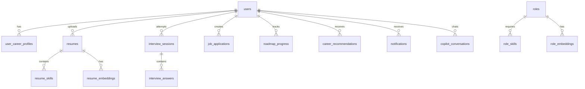

# Lakshya AI — Master API & Data Architecture Map

**Document Version:** 1.0.0  
**Audit Date:** 2026-10-23  
**Status:** Authoritative Interface Mapping  
**Classification:** API Specification & Data Model Reference  

---

## 1. Frontend API Clients & Services Overview

All frontend HTTP communication routes through Axios via `src/services/api.ts`.
- **Base URL Resolution:** In development, points to `http://127.0.0.1:10000/api` or relative `/api` (proxied by Vite).
- **Security Interceptors:** Attaches `Authorization: Bearer <token>` and `X-Request-ID`. Automatically checks API reachability.
- **Client Service Mapping:**
  - `auth.ts`: Authentication, login, register, OAuth, email verification, session validation.
  - `intelligenceService.ts`: `/api/intelligence/overview`, `/api/intelligence/recommendations`.
  - `analyticsService.ts`: `/api/analytics/summary`, `/api/analytics/ats-trend`, `/api/analytics/skill-growth`, `/api/analytics/career-progress`.
  - `resumeService.ts`: `/api/resume/upload`, `/api/resume/:id`, `/api/resume/rewrite`, `/api/resume/export-pdf`.
  - `interviewService.ts`: `/api/interview/setup`, `/api/interview/session`, `/api/interview/answer`, `/api/interview/report`.
  - `applicationTrackerService.ts`: `/api/applications/`, status updates, interview schedules.
  - `roadmapService.ts`: `/api/roadmap/generate`, `/api/roadmap/progress`.
  - `jobsService.ts`: `/api/jobs/matches`, `/api/jobs/live`.
  - `copilotService.ts`: `/api/copilot/chat`, `/api/copilot/history`.
  - `adminService.ts`: `/api/admin/*` (dashboard, users, simulation, features, audit, database).

---

## 2. Master Backend Route & Schema Registry

FastAPI mounts all platform routes under the `/api` prefix via `app/api/router.py`.

| HTTP Method | Route Endpoint | Router Module | Auth & Scoping Required | Backend Handler | Primary Models Involved | External Service / AI |
| :--- | :--- | :--- | :--- | :--- | :--- | :--- |
| `POST` | `/api/auth/register` | `auth.py` | Public | `register()` | `models.User`, `models.UserCareerProfile`, `VerificationToken` | SMTP (Optional) |
| `POST` | `/api/auth/login` | `auth.py` | Public | `login()` | `models.User` | None |
| `POST` | `/api/auth/verify-email` | `auth.py` | Public | `verify_email()` | `models.User`, `VerificationToken` | None |
| `GET` | `/api/auth/google/login` | `auth.py` | Public | `google_login()` | None | Google OAuth 2.0 |
| `GET` | `/api/auth/google/callback`| `auth.py` | Public | `google_callback()` | `models.User` | Google OAuth 2.0 |
| `GET` | `/api/users/me` | `users.py` | `get_current_user` | `get_user_profile()` | `models.User`, `models.UserCareerProfile` | None |
| `PUT` | `/api/users/me` | `users.py` | `get_current_user` (Read-only blocked in simulation) | `update_user_profile()` | `models.User` | None |
| `GET` | `/api/intelligence` | `intelligence.py` | `get_current_user` | `get_intelligence()` | `Resume`, `CareerGoal`, `Role`, `RoadmapProgress`, `InterviewSession`, `CareerRecommendation` | None (Heuristics) |
| `GET` | `/api/intelligence/overview` | `intelligence.py` | `get_current_user` | `get_intelligence_overview()` | Same as `/intelligence` | None (Heuristics) |
| `GET` | `/api/analytics/summary` | `analytics.py` | `get_current_user` | `get_analytics_summary()` | `Resume`, `InterviewSession`, `UserSkillProgress`, `UserCareerState` | None |
| `GET` | `/api/analytics/career-progress`| `analytics.py` | `get_current_user` | `get_career_progress()` | `models.UserPerformanceTrend`, `models.Resume` | None |
| `GET` | `/api/analytics/ats-trend` | `analytics.py` | `get_current_user` | `get_ats_trend()` | `models.Resume` | None |
| `GET` | `/api/analytics/skill-growth` | `analytics.py` | `get_current_user` | `get_skill_growth()` | `models.UserSkillProgress` | None |
| `POST` | `/api/resume/upload` | `resume.py` | `get_current_user` | `upload_resume()` | `models.Resume`, `models.ResumeSkill`, `models.ResumeEmbedding` | `pdfplumber`, `EmbeddingEngine` |
| `GET` | `/api/resume/{id}` | `resume.py` | `get_current_user` (scoped to user) | `get_resume()` | `models.Resume` | None |
| `POST` | `/api/resume/rewrite` | `resume.py` | `get_current_user` | `rewrite_bullet()` | `models.ResumeRewrite` | Groq / LLM Client / Heuristic |
| `POST` | `/api/roles/analyze` | `role.py` | `get_current_user` | `analyze_role()` | `models.Role`, `models.RoleSkill`, `models.UserCareerState` | Embedding Similarity |
| `POST` | `/api/roadmap/generate` | `roadmap.py` | `get_current_user` | `generate_roadmap()` | `models.RoadmapProgress` | Groq / RoadmapEngine (7 Curated Tracks Fallback) |
| `GET` | `/api/roadmap/progress` | `roadmap.py` | `get_current_user` | `get_roadmap_progress()`| `models.RoadmapProgress` | None |
| `POST` | `/api/interview/setup` | `interview.py` | `get_current_user` | `setup_session()` | `models.InterviewSession` | Groq / QuestionGenerator (7-Role Offline Bank Fallback) |
| `POST` | `/api/interview/session/{id}/answer` | `interview.py` | `get_current_user` | `submit_answer()` | `InterviewSession`, `InterviewAnswer` | Groq STAR Rubric / Heuristic Fallback (`is_ai_evaluated`) |
| `GET` | `/api/interview/report/{id}` | `interview.py` | `get_current_user` | `get_report()` | `InterviewSession`, `InterviewAnswer` | None |
| `POST` | `/api/voice/process` | `voice.py` | `get_current_user` | `process_voice()` | None | Web Speech / Whisper |
| `GET` | `/api/applications` | `applications.py`| `get_current_user` | `list_applications()` | `models.JobApplication` | None |
| `POST` | `/api/applications` | `applications.py`| `get_current_user` (Read-only blocked in simulation) | `create_application()` | `models.JobApplication` | None |
| `GET` | `/api/jobs/matches` | `jobs.py` | `get_current_user` | `get_job_matches()` | `models.JobMatchCache` | Remotive API / Fallback |
| `POST` | `/api/copilot/chat` | `copilot.py` | `get_current_user` | `copilot_chat()` | `models.CopilotConversation` | Groq (`llama-3.3-70b-versatile`) / OpenRouter / OpenAI |
| `GET` | `/api/notifications` | `notifications.py`| `get_current_user` | `list_notifications()` | `models.Notification` | None |
| `POST` | `/api/admin/simulation/start` | `admin.py` | `require_super_admin` | `start_simulation()` | `models.User`, `models.AdminAuditLog` | None |
| `POST` | `/api/admin/simulation/end` | `admin.py` | `get_current_user` | `end_simulation()` | `models.AdminAuditLog` | None |
| `GET` | `/api/admin/dashboard` | `admin.py` | `require_admin` | `admin_dashboard()` | Multiple Models Aggregated | None |
| `GET` | `/api/admin/users` | `admin.py` | `require_admin` | `list_admin_users()` | `models.User` | None |
| `GET` | `/api/admin/database/tables` | `admin.py` | `require_super_admin` | `list_database_tables()`| `app.services.admin_table_registry` | None |
| `GET` | `/api/health` | `main.py` | Public | `health_check()` | None | None |
| `GET` | `/api/health/ready` | `main.py` | Public | `readiness_check()` | Database Connection Check | None |

---

## 3. Database Models & Schema Relationships

The platform defines exactly **37 SQLAlchemy ORM models** in `lakshyaai-backend/app/db/models.py`.

### Core Entity Breakdown:
1. **User Identity & Security (`users`):**
   - Fields: `id` (UUID pk), `email` (unique, indexed), `password_hash`, `full_name`, `role` (`user`, `admin`, `super_admin`, `reviewer`), `is_active`, `is_suspended`, `suspended_reason`, `is_email_verified`, `created_at`, `updated_at`.
2. **Career State & Intelligence:**
   - `user_career_profiles`: Onboarding state, experience level, target salary, target location.
   - `user_career_states`: Aggregated readiness score, role compatibility percentage.
   - `career_recommendations`: Action items with impact, confidence, and urgency weights.
   - `career_goals`: Active target role, timeline, and company preferences.
3. **Resume & Analysis:**
   - `resumes`: Raw text, parsed JSON, ATS score, file path, template type.
   - `resume_skills`: Extracted candidate skills with categorized tags.
   - `resume_embeddings`: 1536-dimensional embedding vectors (`Vector(1536)`).
   - `resume_rewrites`: AI bullet rewrites with improvement rationale.
4. **Interview Pipeline:**
   - `interview_sessions`: Target role, track, difficulty level, overall score, status.
   - `interview_answers`: Candidate transcript, technical/communication scores, feedback text.
5. **Roles & Skills Ontology:**
   - `roles`: Industry benchmarks (e.g. "Backend Engineer", "Full Stack Developer").
   - `role_skills`: Core skills, weight, and importance level.
   - `role_embeddings`: 1536-dimensional reference vectors.
6. **Applications & Job Matches:**
   - `job_applications`: Company, job title, pipeline status, salary, application date.
   - `job_match_caches`: Cached job matches with compatibility scores.
7. **Administration & Telemetry:**
   - `admin_audit_logs`: Detailed tracking of admin actions, simulation start/stop, and user suspensions.
   - `feature_flags`: Dynamic flag toggles with percentage rollouts.

---

## 4. AI Service Integrations & Reality Matrix

| Service Module | Declared Capability | Actual Implementation Reality | Status | Fallback / Risk |
| :--- | :--- | :--- | :--- | :--- |
| **`EvaluationEngine`** | AI Mock Interview Evaluation | Deterministic keyword count & string length formula (+12 pts for period) | `MOCK_OR_HARDCODED` | Produces canned feedback regardless of answer quality |
| **`QuestionGenerator`** | Personalized Interview Question Generation | Static Python dictionary with 9 questions per role | `MOCK_OR_HARDCODED` | Fails to test candidate's real resume skills or gap areas |
| **`RoadmapEngine`** | Dynamic AI Learning Roadmap Generation | Static hardcoded dictionary with 2 roles (`frontend`, `backend`) | `MOCK_OR_HARDCODED` | Other roles coerced to backend; static URLs returned |
| **`CareerCopilotService`** | Context-Aware Career Assistant Chat | Calls OpenRouter GPT-4o-mini; system prompt has 0 candidate context | `PARTIALLY_IMPLEMENTED` | Missing candidate profile injection; synchronous blocking HTTP |
| **`EmbeddingEngine`** | Neural Vector Embedding Generation | Calls OpenAI/OpenRouter embeddings API; falls back to SHA-256 token hash | `MOCK_OR_HARDCODED` | SHA-256 hash embeddings produce meaningless cosine similarities |
| **`RecommendationEngine`** | Predictive Next Best Actions | Rule-based decision tree prioritizing missing skills and interview scores | `IMPLEMENTED_AND_VERIFIED` | Truthful heuristics with weighted scoring; no fake AI claims |
| **`LatexCompiler`** | AI Resume Formatting & PDF Compilation | Compiles LaTeX templates via `pdflatex` CLI command | `PARTIALLY_VERIFIED` | Verified in code; blocked on local host due to absent Docker engine |

---

## 5. Mismatches, Stale Routes, & Abandoned Features

1. **Deprecated/Stale Endpoints:**
   - `/api/intelligence` was originally required by legacy pages, while dashboard requested `/api/intelligence/overview`. Successfully aliased under `DASH-01`.
   - `/api/analytics/career-progress` was missing in earlier iterations; implemented under `DASH-02`.
2. **Disconnected Frontend Views:**
   - `src/pages/ResumeDetailPage.tsx` was deleted in prior cleanup; routing now points to `ResumeViewPage.tsx` (`/resume/:id`).
   - `VoiceInterviewPage.tsx` runs browser speech recognition, but speech transcripts are not wired to database persistence.
3. **Simulation Mutation Block:**
   - Any mutating endpoint (`POST`, `PUT`, `PATCH`, `DELETE`) called while attaching `X-Simulation-Token` is rejected with HTTP 403, except `/api/admin/simulation/end`.
