# Lakshya AI — Dependency-Aware Remediation Roadmap

**Roadmap Version:** 2.0 (Post-Audit Master Plan)  
**Baseline Audit Reference:** [COMPLETE_PROJECT_AUDIT.md](file:///c:/Users/91807/Desktop/MY%20projects/lakshya-ai-career-platform/docs/COMPLETE_PROJECT_AUDIT.md)  
**Issue Register Reference:** [PROJECT_ISSUE_REGISTER.md](file:///c:/Users/91807/Desktop/MY%20projects/lakshya-ai-career-platform/docs/PROJECT_ISSUE_REGISTER.md)  
**Execution Strategy:** Strict dependency ordering. High-risk security and data integrity prerequisites precede business logic enhancements and UI polish.

---

## 1. Remediation Phase Dependency Graph

```mermaid
graph TD
    subgraph "Phase 1: Critical Security & Deployment Fixes (P0)"
        T1_1["Task 1.1: Fix Simulation Token Scoping in Auth Dependencies (ARCH-01)"]
        T1_2["Task 1.2: Enforce Email Verification Before Super Admin Role Grant (SEC-02)"]
        T1_3["Task 1.3: Initialize Alembic Migrations & Remove DDL from App Startup (DATA-01)"]
        T1_4["Task 1.4: Install LaTeX Packages in Backend Dockerfile (DEVOPS-01)"]
        T1_5["Task 1.5: External Credential Revocation & Rotation Guide (SEC-01)"]
    end

    subgraph "Phase 2: Database Integrity, Vector Indexes & Concurrency (P1)"
        T2_1["Task 2.1: Add HNSW Vector Distance Indexes on Embedding Tables (DATA-02)"]
        T2_2["Task 2.2: Formalize Relationship Cascades on Foreign Keys (DATA-03)"]
        T2_3["Task 2.3: Add Row-Level Locks & Idempotency on Interview Submissions (BUG-01)"]
        T2_4["Task 2.4: Replace Synthetic Fake Scores with Authentic Empty States (DATA-04)"]
        T2_5["Task 2.5: Implement Supabase Row Level Security (RLS) Policies (SEC-03)"]
    end

    subgraph "Phase 3: Genuine AI Grounding & LLM Standardization (P1)"
        T3_1["Task 3.1: Replace Heuristic Interview Scoring with Real LLM STAR Rubric (AI-01)"]
        T3_2["Task 3.2: Implement Dynamic Context-Grounded Interview Question Generator (AI-02)"]
        T3_3["Task 3.3: Implement Dynamic Skill-Gap Career Roadmap Generator (AI-03)"]
        T3_4["Task 3.4: Ground Copilot System Prompt in Candidate Profile & Resume (AI-04)"]
        T3_5["Task 3.5: Remove Fake SHA256 Feature Hashing on Missing Embedding Keys (AI-05)"]
        T3_6["Task 3.6: Unify LLM Provider Interface Across Services (AI-06)"]
        T3_7["Task 3.7: Persist Voice Interview Sessions, Transcripts & Scores (FE-01)"]
        T3_8["Task 3.8: Mask Sensitive Payloads and Remove Raw Print Logging (LOG-01)"]
    end

    subgraph "Phase 4: Production Hardening, Code Quality & DevOps Polish (P2/P3)"
        T4_1["Task 4.1: Convert Synchronous HTTP Calls to Async (PERF-01)"]
        T4_2["Task 4.2: Enforce Strong JWT Secret & Add Refresh Token Endpoint (SEC-04)"]
        T4_3["Task 4.3: Migrate Local Resume Storage to Cloud Object Store (DEVOPS-02)"]
        T4_4["Task 4.4: Prune Unused Packages & Clean Git History (DEV-01)"]
        T4_5["Task 4.5: Resolve 65 ESLint Problems in Frontend (FE-02)"]
        T4_6["Task 4.6: Synchronize Frontend Career Context Readiness with Backend (FE-03)"]
        T4_7["Task 4.7: Implement Resilient Multi-Worker Cache for Live Jobs Feed (API-01)"]
        T4_8["Task 4.8: Add Integration Tests for OAuth & Voice Audio (TEST-02)"]
        T4_9["Task 4.9: Align Documentation with Verified Capabilities (DOC-01, DEP-01)"]
    end

    T1_1 --> T2_3
    T1_3 --> T2_1
    T1_3 --> T2_2
    T1_3 --> T2_5
    T2_3 --> T3_1
    T2_1 --> T3_5
    T3_6 --> T3_1
    T3_6 --> T3_2
    T3_6 --> T3_4
    T3_6 --> T4_1
    T3_7 --> T4_8
```

---

## 2. Phase-by-Phase Task Breakdown

### Phase 1: Critical Security, Access Control & Deployment Fixes (P0)

#### Task 1.1: Fix Simulation Token Scoping in Auth Dependencies
- **Issue Addressed:** `ARCH-01` (Priority: P0)
- **Files Modified:** `lakshyaai-backend/app/core/dependencies.py`
- **Actions:**
  1. In `get_current_user`, extract `X-Simulation-Token` from request headers.
  2. If present, validate token against active `AdminSimulationSession`.
  3. Return the simulated candidate user (`target_user`) while preserving `request.state.actor_id = admin_user.id`.
  4. Ensure `security_middleware.py` continues rejecting mutations (`POST`, `PUT`, `PATCH`, `DELETE`) with 403 Forbidden.
- **Verification:** Run `test_simulation.py` and `test_simulation_global_block.py`.

#### Task 1.2: Enforce Email Verification Before Super Admin Role Grant
- **Issue Addressed:** `SEC-02` (Priority: P0)
- **Files Modified:** `lakshyaai-backend/app/api/routes/auth.py`
- **Actions:**
  1. In `register`, do not auto-elevate user to `super_admin` role until `is_email_verified` is confirmed.
  2. In `login`, enforce that admin role privileges require `is_email_verified=True`.
- **Verification:** Add regression test in `test_account_status_security.py` verifying unverified admin cannot log in as super_admin.

#### Task 1.3: Initialize Alembic Migrations & Remove DDL from App Startup
- **Issue Addressed:** `DATA-01` (Priority: P0)
- **Files Modified:** `lakshyaai-backend/alembic.ini`, `lakshyaai-backend/alembic/`, `lakshyaai-backend/app/main.py`
- **Actions:**
  1. Initialize Alembic pointing to `app.db.database.Base.metadata`.
  2. Generate baseline migration script for all 37 models and `vector` extension.
  3. Remove imperative `ALTER TABLE` statements from `main.py` startup hook.
  4. Configure Alembic to execute migrations via `DIRECT_URL` (port 5432 session pooler).
- **Verification:** Run `alembic upgrade head` cleanly against PostgreSQL.

#### Task 1.4: Install LaTeX Packages in Backend Dockerfile
- **Issue Addressed:** `DEVOPS-01` (Priority: P0)
- **Files Modified:** `lakshyaai-backend/Dockerfile`
- **Actions:**
  1. Add `texlive-latex-base` and `texlive-fonts-recommended` to Dockerfile `apt-get install`.
- **Verification:** Verify `docker build` succeeds and `pdflatex --version` executes inside the container.

#### Task 1.5: External Credential Revocation & Rotation Guide
- **Issue Addressed:** `SEC-01` (Priority: P0)
- **Files Modified:** `docs/SECURITY_RUNBOOK.md` (New)
- **Actions:**
  1. Provide step-by-step runbook for rotating Google OAuth Client Secret, Gmail SMTP App Password, and Supabase Database Password.
  2. Coordinate scheduled git history scrub (`git filter-repo`) after team backup.

---

### Phase 2: Database Integrity, Vector Indexes & Concurrency (P1)

#### Task 2.1: Add HNSW Vector Distance Indexes on Embedding Tables
- **Issue Addressed:** `DATA-02` (Priority: P1)
- **Files Modified:** `lakshyaai-backend/app/db/models.py`, Alembic migration script
- **Actions:**
  1. Add HNSW cosine index to `ResumeEmbedding.embedding` and `RoleEmbedding.embedding`.
- **Verification:** Run `EXPLAIN` query on embedding similarity search to confirm index scan.

#### Task 2.2: Formalize Relationship Cascades on Foreign Keys
- **Issue Addressed:** `DATA-03` (Priority: P1)
- **Files Modified:** `lakshyaai-backend/app/db/models.py`
- **Actions:**
  1. Audit all 37 models and add explicit `cascade="all, delete"` and `ondelete="CASCADE"` to child relationships (`UserSkillProgress`, `InterviewDebrief`, `ApplicationEvent`).
- **Verification:** Add regression test confirming deleting a `User` cascades cleanly without FK violations.

#### Task 2.3: Add Row-Level Locks & Idempotency on Interview Submissions
- **Issue Addressed:** `BUG-01` (Priority: P1)
- **Files Modified:** `lakshyaai-backend/app/services/interview/session_manager.py`
- **Actions:**
  1. In `next_interview_step`, query session using `with_for_update()`.
  2. Reject submission if session is already completed or if current question index doesn't match expected step.
- **Verification:** Create concurrent multi-threaded submission test ensuring exactly 1 submission accepted per step.

#### Task 2.4: Replace Synthetic Fake Scores with Authentic Empty States
- **Issue Addressed:** `DATA-04` (Priority: P1)
- **Files Modified:** `lakshyaai-backend/app/services/career_intelligence_service.py`
- **Actions:**
  1. Remove hardcoded fallback scores (78 ATS score, 75 interview score, TechCorp job match).
  2. Return authentic null or zero values with explicit onboarding status.
- **Verification:** Run `test_intelligence.py` and verify empty profile returns honest empty payload.

#### Task 2.5: Implement Supabase Row Level Security (RLS) Policies
- **Issue Addressed:** `SEC-03` (Priority: P1)
- **Files Modified:** `lakshyaai-backend/alembic/versions/` (RLS migration)
- **Actions:**
  1. Enable RLS on all 37 tables: `ALTER TABLE ... ENABLE ROW LEVEL SECURITY;`.
  2. Add tenant isolation policies: `CREATE POLICY tenant_isolation ON ... FOR ALL USING (auth.uid() = user_id);`.
- **Verification:** Test direct Supabase SQL queries as unauthenticated and authenticated users.

---

### Phase 3: Genuine AI Grounding & LLM Standardization (P1)

#### Task 3.1: Replace Heuristic Interview Scoring with Real LLM STAR Rubric
- **Issue Addressed:** `AI-01` (Priority: P1)
- **Files Modified:** `lakshyaai-backend/app/services/interview/evaluation_engine.py`
- **Actions:**
  1. Construct prompt decomposing candidate answer into Situation, Task, Action, and Result.
  2. Request structured JSON containing technical depth (0-100), communication clarity (0-100), and STAR score (0-100).
  3. Retain heuristic calculation only as fallback when LLM service is unavailable.
- **Verification:** Add unit test in `test_ai_resilience.py` with mock LLM payload.

#### Task 3.2: Implement Dynamic Context-Grounded Interview Question Generator
- **Issue Addressed:** `AI-02` (Priority: P1)
- **Files Modified:** `lakshyaai-backend/app/services/interview/question_generator.py`
- **Actions:**
  1. Generate questions dynamically based on candidate's target role, resume skills, and difficulty level.
  2. Cache generated questions on the `InterviewSession` record.

#### Task 3.3: Implement Dynamic Skill-Gap Career Roadmap Generator
- **Issue Addressed:** `AI-03` (Priority: P1)
- **Files Modified:** `lakshyaai-backend/app/services/roadmap/roadmap_engine.py`
- **Actions:**
  1. Generate personalized milestones targeting the candidate's detected missing skills.
  2. Provide genuine educational resources and realistic weekly milestones.

#### Task 3.4: Ground Copilot System Prompt in Candidate Profile & Resume
- **Issue Addressed:** `AI-04` (Priority: P1)
- **Files Modified:** `lakshyaai-backend/app/api/routes/copilot.py`, `app/services/copilot/chat_service.py`
- **Actions:**
  1. In `copilot_chat`, call `CopilotContextEngine.build_profile(db, user_id=current_user.id)`.
  2. Inject candidate's target role, top skills, detected skill gaps, and ATS score into the system prompt.

#### Task 3.5: Remove Fake SHA256 Feature Hashing on Missing Embedding Keys
- **Issue Addressed:** `AI-05` (Priority: P1)
- **Files Modified:** `lakshyaai-backend/app/services/resume/embedding_engine.py`
- **Actions:**
  1. Remove `_generate_hash_embedding()`.
  2. Return explicit empty vector and log clear warning when embedding API keys are unconfigured.

#### Task 3.6: Unify LLM Provider Interface Across Services
- **Issue Addressed:** `AI-06` (Priority: P2)
- **Files Modified:** `lakshyaai-backend/app/services/llm/client.py`, `app/services/copilot/chat_service.py`, `app/services/voice/`
- **Actions:**
  1. Refactor Copilot and Voice services to use the unified `LLMClient`.
  2. Allow seamless switching between OpenAI, OpenRouter, and Gemini via `LLM_PROVIDER`.

#### Task 3.7: Persist Voice Interview Sessions, Transcripts & Scores
- **Issue Addressed:** `FE-01` (Priority: P1)
- **Files Modified:** `src/components/interview/VoiceInterviewSession.tsx`, `src/pages/InterviewStudioPage.tsx`
- **Actions:**
  1. Create `InterviewSession` on voice interview start.
  2. Post transcribed answers to `/api/interview/session/{id}/answer` to save messages and scores.

#### Task 3.8: Mask Sensitive Payloads and Remove Raw Print Logging
- **Issue Addressed:** `LOG-01` (Priority: P2)
- **Files Modified:** `app/services/copilot/chat_service.py`, `app/services/voice/speech_to_text.py`
- **Actions:**
  1. Replace raw `print()` statements with `logger.debug()` and sanitize candidate resume text.

---

### Phase 4: Production Hardening, Code Quality & DevOps Polish (P2 / P3)

#### Task 4.1: Convert Synchronous HTTP Calls to Async
- **Issue Addressed:** `PERF-01` (Priority: P2)
- **Files Modified:** `app/services/llm/client.py`, `app/services/jobs/job_provider.py`
- **Actions:** Replace synchronous `requests` calls with `httpx.AsyncClient`.

#### Task 4.2: Enforce Strong JWT Secret & Add Refresh Token Endpoint
- **Issue Addressed:** `SEC-04` (Priority: P2)
- **Files Modified:** `app/core/security.py`, `app/api/routes/auth.py`, `src/services/api.ts`
- **Actions:** Disallow `"supersecretkey"` in production; implement `POST /api/auth/refresh`.

#### Task 4.3: Migrate Local Resume Storage to Cloud Object Store
- **Issue Addressed:** `DEVOPS-02` (Priority: P2)
- **Files Modified:** `app/services/storage/file_storage.py`
- **Actions:** Implement S3 / GCS / Supabase Storage provider with presigned URLs.

#### Task 4.4: Prune Unused Packages & Clean Git History
- **Issue Addressed:** `DEV-01` (Priority: P2)
- **Files Modified:** `lakshyaai-backend/requirements.txt`
- **Actions:** Remove `pyiceberg`, `supabase`, `postgrest`, `realtime`, `storage3`.

#### Task 4.5: Resolve 65 ESLint Problems in Frontend
- **Issue Addressed:** `FE-02` (Priority: P2)
- **Files Modified:** Frontend source files
- **Actions:** Run `npm run lint -- --fix` and replace explicit `any` types.

#### Task 4.6: Synchronize Frontend Career Context Readiness with Backend
- **Issue Addressed:** `FE-03` (Priority: P2)
- **Files Modified:** `src/context/CareerContext.tsx`
- **Actions:** Remove hardcoded scores (40, 85); read calculated scores from `/api/intelligence`.

#### Task 4.7: Implement Resilient Multi-Worker Cache for Live Jobs Feed
- **Issue Addressed:** `API-01`, `PERF-02` (Priority: P2)
- **Files Modified:** `app/services/jobs/job_provider.py`
- **Actions:** Store cached jobs in Redis or database table; add fallback on API rate limit.

#### Task 4.8: Add Integration Tests for OAuth & Voice Audio
- **Issue Addressed:** `TEST-02` (Priority: P2)
- **Files Modified:** `tests/test_oauth_flow.py`, `tests/test_voice_flow.py`
- **Actions:** Add end-to-end integration tests with mocked OAuth providers.

#### Task 4.9: Align Documentation with Verified Capabilities
- **Issue Addressed:** `DOC-01`, `DEP-01` (Priority: P3)
- **Files Modified:** `docs/API.md`, `docs/ARCHITECTURE.md`, `README.md`, `app/core/security.py`
- **Actions:** Update documentation to reflect authentic system capabilities and replace `datetime.utcnow()`.
