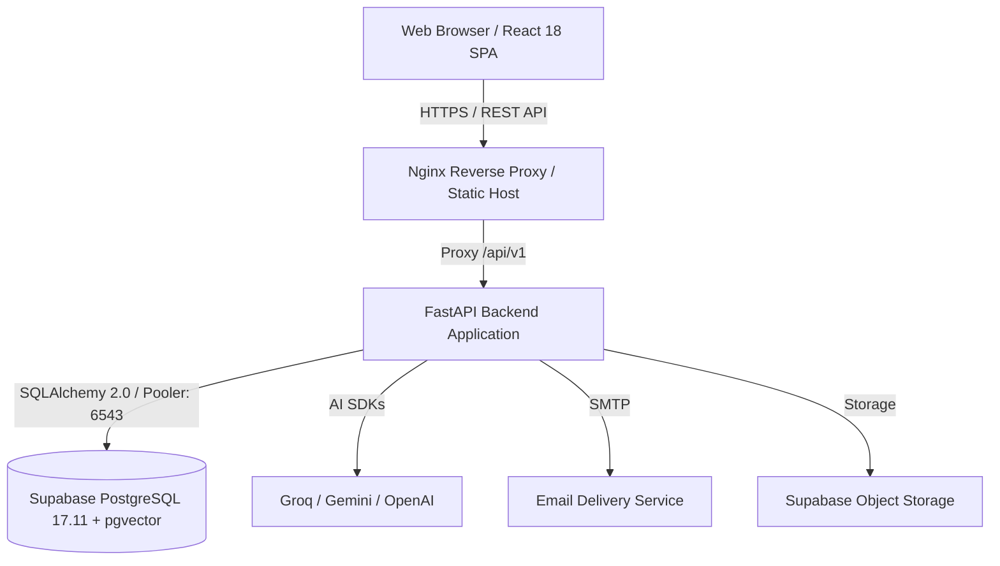

# 01 — Repository Architecture Audit

**Project:** Lakshya AI Career Platform  
**Repository:** `https://github.com/srikanthraj9/lakshya-ai-career-platform.git`  
**Audit Date:** October 25, 2026  
**Auditor:** Senior Full-Stack Architect & Security Reviewer  

---

## 1. High-Level System Overview

Lakshya AI is a full-stack, AI-native career navigation and acceleration platform. It provides candidates with intelligent resume analysis (ATS parsing, missing skill identification, ATS breakdown, PDF export), career goal tracking, interactive AI copilot guidance, mock interview studio with real-time feedback and debriefs, job discovery & application tracking, skill passport, and a comprehensive role-based administrative control center.



---

## 2. Technology Stack & Actual Versions

Dependency manifests (`package.json`, `lakshyaai-backend/requirements.txt`, `pyproject.toml`) establish the verified technology stack:

### Frontend
- **Runtime & Build Tool:** Node.js (compatible with >=18 / Bun), Vite `5.4.19`, `@vitejs/plugin-react` `4.3.4`
- **Core Framework:** React `18.3.1`, React DOM `18.3.1`
- **Language:** TypeScript `5.8.3`
- **State Management & Data Fetching:** `@tanstack/react-query` `5.83.0` (server state), React Context API (`AuthContext`, `NotificationContext`)
- **Styling & UI Kit:** Tailwind CSS `3.4.17`, PostCSS `8.4.49`, Lucide React `0.475.0`, `tailwind-merge` `3.0.1`, `clsx` `2.1.1`
- **HTTP Client:** Axios `1.13.6` with request/response interceptors for token injection, refresh, and simulation mode headers
- **Routing:** `react-router-dom` `7.2.0`
- **Testing:** Vitest `3.0.5`, `@testing-library/react` `16.2.0`, `@testing-library/jest-dom` `6.6.3`, JSDOM `26.0.0`
- **E2E Testing:** Playwright `@playwright/test` `1.50.1`

### Backend
- **Framework:** FastAPI (Python >= 3.10, tested on 3.12), Starlette, Uvicorn (ASGI server)
- **Language:** Python 3.12
- **Data Validation & Schemas:** Pydantic v2 (`pydantic-settings`)
- **ORM & Database Client:** SQLAlchemy `2.0.x`, `psycopg2-binary` (PostgreSQL driver), `pgvector`
- **Database Migrations:** Alembic `1.13.x`
- **Security & Authentication:** `python-jose[cryptography]`, `passlib[bcrypt]`, Bcrypt
- **AI / LLM Clients:** Groq SDK (`groq`), Google Generative AI (`google-generativeai`), OpenAI (`openai`)
- **PDF Generation & Document Processing:** `reportlab`, `PyPDF2`, `python-docx`
- **Testing:** `unittest`, `pytest`, `httpx` (AsyncClient / TestClient)

---

## 3. Repository Directory Structure

```
lakshya-ai-career-platform/
├── .github/
│   └── workflows/
│       ├── ci.yml                 # CI & Release Gate (Frontend + Backend + Scans)
│       ├── cd.yml                 # Continuous Deployment workflow
│       └── db-verify.yml          # Database schema & migration verification
├── docs/                          # Architectural documentation, audit reports, runbooks
│   └── audit/                     # Phased audit reports (01 to 08)
├── lakshyaai-backend/             # Python FastAPI backend service
│   ├── alembic/                   # Database migration scripts & env.py
│   ├── app/
│   │   ├── api/
│   │   │   ├── deps.py            # Security & dependency injection (Auth, Roles, DB session)
│   │   │   └── routes/            # REST API endpoints (auth, admin, copilot, interview, etc.)
│   │   ├── core/                  # Configuration, security, logging, rate limiting
│   │   ├── db/                    # SQLAlchemy database engine, session makers, base models
│   │   └── services/              # Business logic (ATS parsing, AI copilot, email verification)
│   ├── scripts/                   # DB backup/restore, seed scripts, disaster recovery
│   └── tests/                     # 221 automated unit, integration, and security tests
├── public/                        # Static web assets, favicon, logos
├── src/                           # React frontend application
│   ├── components/                # Modular UI components (admin, auth, copilot, common)
│   ├── context/                   # React context providers (AuthContext, NotificationContext)
│   ├── hooks/                     # Custom React hooks (useAuth, useToast, useDebounce)
│   ├── pages/                     # Routed view components (candidate workflows + admin pages)
│   │   └── admin/                 # Dedicated Admin sub-pages (10 views)
│   ├── services/                  # Frontend API service layer (api.ts, adminService.ts, etc.)
│   ├── types/                     # TypeScript interfaces and domain schemas
│   ├── App.tsx                    # Top-level client router and route guards
│   └── main.tsx                   # React DOM entry point
├── Dockerfile                     # Multi-stage production container build (frontend)
├── docker-compose.yml             # Local orchestrated development stack
├── docker-compose.prod.yml        # Production container configuration
├── nginx.conf                     # Production web server and reverse proxy
├── package.json                   # Frontend dependencies and build scripts
└── vite.config.ts                 # Vite bundler configuration
```

---

## 4. Architectural Boundaries and Request Flow

1. **Client-Side Routing & Security Guards:**
   - Public Routes (`/`, `/login`, `/register`, `/verify-email`, `/forgot-password`)
   - Protected Candidate Routes (`/dashboard`, `/profile`, `/resume`, `/interview`, `/copilot`, `/jobs`, `/roadmap`) guarded by `ProtectedRoute`
   - Protected Admin Routes (`/admin/*`) guarded by `AdminRoute` requiring `role in ['admin', 'super_admin']`

2. **API Communication Protocol:**
   - Centralized Axios client (`src/services/api.ts`) configured with `baseURL: /api/v1` (proxied in Vite or Nginx to backend).
   - Bearer token authentication via `Authorization: Bearer <JWT>` header automatically attached from `localStorage`.
   - Simulation header injection (`X-Simulation-Token`) when an administrator engages "View As Candidate" simulation.
   - Centralized 401 response interceptor clearing expired sessions.

3. **Backend Route Registration:**
   - All REST controllers mounted under `/api/v1` in `lakshyaai-backend/app/main.py`:
     - `/auth` (Authentication, verification, password reset)
     - `/admin` (Administrative dashboard, analytics, users, audit, system)
     - `/resumes` (Resume upload, parsing, ATS analysis, rewriting)
     - `/copilot` (Conversational AI career mentor)
     - `/interview` (Mock interview questions, transcripts, debrief reports)
     - `/jobs` (Job application tracking, recommendations)
     - `/roadmap` (Personalized skill milestones)
     - `/passport` (Verifiable candidate skill passport)
     - `/notifications` (User alerts and announcements)
     - `/health` (Readiness and liveness probes)

4. **Persistence & Data Isolation:**
   - Managed PostgreSQL instance hosted on Supabase (port 6543 connection pooler).
   - ORM mappings with declarative models in `lakshyaai-backend/app/db/models.py`.
   - Row-level multitenancy strictly enforced by `user_id` foreign keys and dependency injection filters in backend queries.
