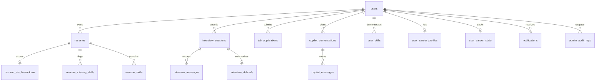

# 04 — Database Schema and Data Flow

**Project:** Lakshya AI Career Platform  
**Repository:** `https://github.com/srikanthraj9/lakshya-ai-career-platform.git`  
**Audit Date:** October 25, 2026  
**Auditor:** Senior Database Architect & Backend Engineer  

---

## 1. Verified PostgreSQL Table Catalog

Live inspection of the Supabase PostgreSQL database confirms **37 active tables** in the `public` schema:

### A. Identity, Authentication & Administrative Auditing
1. `users` — Primary account table (`id`, `email`, `hashed_password`, `role`, `is_active`, `is_verified`, `created_at`, `updated_at`). Roles: `user`, `admin`, `super_admin`.
2. `email_verification_tokens` — Account activation & recovery tokens (`id`, `user_id`, `token_hash`, `expires_at`, `is_used`).
3. `admin_audit_logs` — Tamper-evident admin log (`id`, `admin_id`, `action`, `target_resource`, `target_id`, `details`, `ip_address`, `timestamp`).
4. `admin_simulation_sessions` — Active "View As Candidate" impersonation tokens (`id`, `admin_id`, `target_user_id`, `token_hash`, `expires_at`, `is_active`).
5. `feature_flags` — Dynamic system toggles (`id`, `key`, `name`, `description`, `is_enabled`, `updated_by`, `updated_at`).
6. `platform_announcements` — System notices (`id`, `title`, `content`, `target_role`, `is_active`, `created_by`, `created_at`, `expires_at`).

### B. Candidate Profile & Career Progression
7. `user_career_profiles` — Candidate profile details (`user_id`, `full_name`, `target_role`, `experience_years`, `bio`, `headline`, `location`).
8. `user_career_state` — State machine of candidate progress (`user_id`, `onboarding_completed`, `resume_uploaded`, `first_interview_completed`).
9. `career_goals` — Active and archived candidate goals (`id`, `user_id`, `title`, `target_date`, `status`).
10. `career_activities` — Candidate timeline actions (`id`, `user_id`, `activity_type`, `description`, `created_at`).
11. `career_recommendations` — AI recommended actions (`id`, `user_id`, `title`, `category`, `impact_score`, `is_completed`).
12. `career_insight_snapshots` — Aggregated snapshot metrics per candidate.
13. `career_automation_rules` — Automated workflow triggers.
14. `user_feedback` — Candidate platform feedback.
15. `outcome_learning_insights` — Long-term career tracking outcome signals.

### C. Resume Parsing, ATS Scoring & Embeddings
16. `resumes` — Uploaded documents (`id`, `user_id`, `file_name`, `storage_path`, `raw_text`, `overall_ats_score`, `created_at`).
17. `resume_ats_breakdown` — Category scoring: formatting, keywords, impact, brevity.
18. `resume_skills` — Extracted candidate skills with proficiency levels.
19. `resume_missing_skills` — Identified skill gaps against target role standards.
20. `resume_rewrites` — Historical AI bullet point refinements.
21. `resume_embeddings` — Vector representation (`pgvector`) of candidate resumes.

### D. Mock Interview Studio
22. `interview_sessions` — Interview instances (`id`, `user_id`, `role_title`, `seniority`, `overall_score`, `status`, `created_at`).
23. `interview_messages` — Full transcript (`id`, `session_id`, `speaker`, `content`, `star_feedback`, `timestamp`).
24. `interview_debriefs` — Final evaluation report (`session_id`, `strengths`, `improvements`, `hiring_decision`, `created_at`).

### E. AI Copilot Mentorship
25. `copilot_conversations` — Chat threads (`id`, `user_id`, `title`, `created_at`, `updated_at`).
26. `copilot_messages` — Chat messages (`id`, `conversation_id`, `role`, `content`, `model_name`, `latency_ms`, `tokens_used`).

### F. Job Discovery & Applications
27. `job_applications` — Kanban cards (`id`, `user_id`, `company_name`, `job_title`, `status`, `salary_range`, `applied_date`).
28. `application_events` — Application milestones (interview scheduled, offer received).
29. `company_intelligence` — Scraped / AI-synthesized company culture and salary insights.

### G. Skill Passport & Career Roadmaps
30. `roles` — Standardized market roles (`id`, `name`, `department`, `description`).
31. `role_skills` — Core competencies mapped to standardized roles.
32. `role_embeddings` — Vector embeddings for semantic role matching.
33. `user_skills` — Verified candidate competencies (`id`, `user_id`, `skill_name`, `verified_level`, `share_token`).
34. `user_skill_progress` — Time-series progression curves.
35. `roadmap_progress` — Node completion state on candidate learning path.
36. `user_performance_trend` — Longitudinal career progression trends.
37. `notifications` — In-app alerts (`id`, `user_id`, `title`, `message`, `is_read`, `created_at`).

---

## 2. Key Relationships and Referential Integrity

All foreign keys use `ON DELETE CASCADE` on appropriate child entities (e.g., deleting a resume cascades to its ATS breakdowns and extracted skills). User accounts maintain referential integrity with strict cascade rules.
