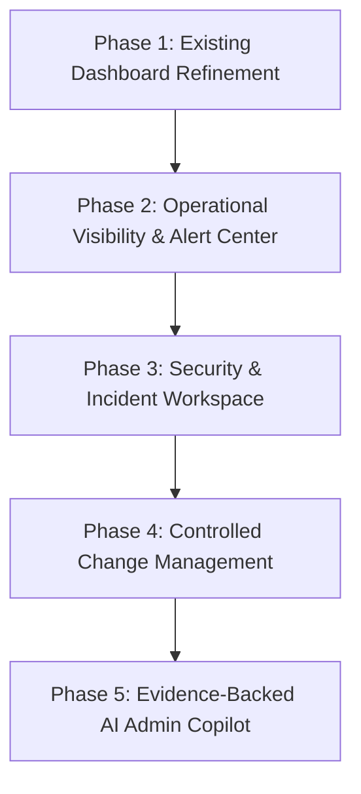

# Lakshya AI Super Admin Dashboard — Enhancement Gap Analysis & Execution Plan

**Document Reference:** `docs/audit/29-super-admin-enhancement-gap-analysis.md`  
**Date:** October 27, 2026  
**Auditor / Architect:** Principal Full-Stack Engineer & Operations Architect  
**Project:** Lakshya AI Career Platform  
**Target:** Super Admin Operations Center Evolution  
**Status:** Completed — Ready for Phased Execution  

---

## 1. Executive Summary

This document performs an exhaustive, code-level gap analysis comparing the existing **Lakshya AI Super Admin Dashboard** against the proposed **Portfolio Improvement & Enhancement Plan**.

The Lakshya AI Super Admin Dashboard currently comprises **10 major operational modules** spanning both frontend and backend implementations. The core architecture is robust, honest (backed by direct database calculations and real telemetry), and hardened with security controls (e.g., View-As read-only token enforcement, super admin bootstrap immutability, and 38-table registry allowlisting).

The goal of this enhancement plan is **incremental evolution** into an **Intelligent Platform Operations Center** without breaking existing features, without altering production schemas, and without rebuilding working modules.

---

## 2. Codebase Audit: Current State vs. Target Capabilities

Below is an evidence-based audit of each existing module in the workspace:

| Module | Primary Files | Current State & Capabilities | Proposed Enhancement Direction | Technical Readiness |
| :--- | :--- | :--- | :--- | :---: |
| **1. Overview** | [AdminDashboardPage.tsx](file:///c:/Users/91807/Desktop/MY%20projects/lakshya-ai-career-platform/src/pages/admin/AdminDashboardPage.tsx) [platform_analytics_service.py](file:///c:/Users/91807/Desktop/MY%20projects/lakshya-ai-career-platform/lakshyaai-backend/app/services/platform_analytics_service.py) | 8 live KPI cards, quick actions, direct database counts, honest zero telemetry. | Add compact actionable alert banner, time-range selectors, card-to-module deep links, data freshness timestamps. | **High** (Purely additive UI + query filters) |
| **2. User Management** | [AdminUsersPage.tsx](file:///c:/Users/91807/Desktop/MY%20projects/lakshya-ai-career-platform/src/pages/admin/AdminUsersPage.tsx) [UserManagementTable.tsx](file:///c:/Users/91807/Desktop/MY%20projects/lakshya-ai-career-platform/src/components/admin/UserManagementTable.tsx) [UserDetailDrawer.tsx](file:///c:/Users/91807/Desktop/MY%20projects/lakshya-ai-career-platform/src/components/admin/UserDetailDrawer.tsx) | Search, role filtering, suspension toggle, drawer with edit/role controls, bootstrap protection. | Bulk selection/actions, historical account timeline, explicit destructive confirmation modals. | **High** (Backend user service supports bulk queries) |
| **3. Candidate 360° Workspace** | [AdminUserWorkspacePage.tsx](file:///c:/Users/91807/Desktop/MY%20projects/lakshya-ai-career-platform/src/pages/admin/AdminUserWorkspacePage.tsx) [ViewAsBanner.tsx](file:///c:/Users/91807/Desktop/MY%20projects/lakshya-ai-career-platform/src/components/admin/ViewAsBanner.tsx) [simulation_service.py](file:///c:/Users/91807/Desktop/MY%20projects/lakshya-ai-career-platform/lakshyaai-backend/app/services/simulation_service.py) | Deep candidate inspection across 7 tabs (Resumes, Interviews, Applications, Copilot, Activities, Audit), View-As simulation session with backend mutation guard (`X-Simulation-Token`). | Unified chronological candidate timeline, enhanced visual distinction between inspection vs. simulation, missing profile data warnings. | **High** (Activity timeline already partially integrated) |
| **4. Platform Analytics** | [AdminAnalyticsPage.tsx](file:///c:/Users/91807/Desktop/MY%20projects/lakshya-ai-career-platform/src/pages/admin/AdminAnalyticsPage.tsx) | User growth chart, onboarding step funnel, interview metrics, application tracker funnel. | Date range selector (7d/30d/90d/1y), cohort comparisons, exportable CSV/JSON reports, data freshness indicators. | **Medium** (Requires backend query date-filtering params) |
| **5. AI Usage & Telemetry** | [AdminAIPage.tsx](file:///c:/Users/91807/Desktop/MY%20projects/lakshya-ai-career-platform/src/pages/admin/AdminAIPage.tsx) [ai_telemetry_service.py](file:///c:/Users/91807/Desktop/MY%20projects/lakshya-ai-career-platform/lakshyaai-backend/app/services/ai_telemetry_service.py) | Total inferences, token volume, model breakdown, latency statistics, recent request logs. | Provider comparisons (Groq vs. Gemini vs. OpenAI), error rate trends, explicit telemetry limitation badges, token cost estimator. | **High** (Underlying `ai_request_telemetry` table active) |
| **6. Feature Flags** | [AdminFeaturesPage.tsx](file:///c:/Users/91807/Desktop/MY%20projects/lakshya-ai-career-platform/src/pages/admin/AdminFeaturesPage.tsx) [FeatureFlagManager.tsx](file:///c:/Users/91807/Desktop/MY%20projects/lakshya-ai-career-platform/src/components/admin/FeatureFlagManager.tsx) [feature_flag_service.py](file:///c:/Users/91807/Desktop/MY%20projects/lakshya-ai-career-platform/lakshyaai-backend/app/services/feature_flag_service.py) | List, toggle on/off, target role assignment, search, role validation. | Gradual rollout percentage slider, configuration change audit log, one-click rollback to previous state. | **Medium** (Requires adding `rollout_percentage` field to `feature_flags`) |
| **7. Announcements** | [AdminAnnouncementsPage.tsx](file:///c:/Users/91807/Desktop/MY%20projects/lakshya-ai-career-platform/src/pages/admin/AdminAnnouncementsPage.tsx) [AnnouncementManager.tsx](file:///c:/Users/91807/Desktop/MY%20projects/lakshya-ai-career-platform/src/components/admin/AnnouncementManager.tsx) | Title, content, priority, audience target, publish/unpublish, delete. | Draft preview modal, start & expiration timestamps, publication history log, confirmation before broadcast. | **High** (Schema already has `expires_at` column) |
| **8. System Health** | [AdminSystemPage.tsx](file:///c:/Users/91807/Desktop/MY%20projects/lakshya-ai-career-platform/src/pages/admin/AdminSystemPage.tsx) [SystemHealthPanel.tsx](file:///c:/Users/91807/Desktop/MY%20projects/lakshya-ai-career-platform/src/components/admin/SystemHealthPanel.tsx) [health_service.py](file:///c:/Users/91807/Desktop/MY%20projects/lakshya-ai-career-platform/lakshyaai-backend/app/services/health_service.py) | Live readiness & liveness status, database ping, rate limiter status, environment checks. | Service dependency status (FastAPI, Supabase Pooler, Groq AI API, SMTP), last-checked timestamp, links to diagnostics. | **High** (`/api/health/ready` already returns structured component status) |
| **9. Governance & Audit** | [AdminAuditPage.tsx](file:///c:/Users/91807/Desktop/MY%20projects/lakshya-ai-career-platform/src/pages/admin/AdminAuditPage.tsx) [AuditLogTable.tsx](file:///c:/Users/91807/Desktop/MY%20projects/lakshya-ai-career-platform/src/components/admin/AuditLogTable.tsx) [audit_service.py](file:///c:/Users/91807/Desktop/MY%20projects/lakshya-ai-career-platform/lakshyaai-backend/app/services/audit_service.py) | Server-side pagination, search, action filter, severity filter, actor filter, JSON metadata viewer, CSV export. | Correlation ID linking, event grouping, security incident view, detailed event drawer. | **High** (`X-Request-ID` middleware already attaches request IDs) |
| **10. Database Explorer** | [AdminDatabasePage.tsx](file:///c:/Users/91807/Desktop/MY%20projects/lakshya-ai-career-platform/src/pages/admin/AdminDatabasePage.tsx) [admin_table_registry.py](file:///c:/Users/91807/Desktop/MY%20projects/lakshya-ai-career-platform/lakshyaai-backend/app/services/admin_table_registry.py) | Curated 38-table allowlist, pagination, field masking (passwords, tokens), destructive mutation protection. | Table relationship metadata documentation, read-only query runner with strict limits, mandatory audit reason capture for record updates. | **High** (Table registry already enforces field allowlists) |

---

## 3. Advanced Capabilities Architecture (Sections 4 & 6)

The roadmap proposes five high-value operational additions:

### 3.1 Intelligent Alert Center & Incident Workspace
- **Concept:** Centralize critical system alerts (database pool saturation, repeated AI timeouts, 401 spikes, rate limit exhaustion).
- **Architecture:** Reuses existing `AdminAuditLog` events + `HealthService` metrics to derive active alerts without requiring a heavy new database subsystem.
- **Workflow:** Acknowledge ➔ Investigate (links to request ID / audit trail) ➔ Resolve.

### 3.2 Security Operations View
- **Concept:** Dedicated security perspective within Governance & Audit.
- **Metrics:** Failed login trends, privilege escalation events, simulated session triggers, rate limit triggers.
- **Integration:** Leverages existing audit logs with action types `AUTH_FAILURE`, `ROLE_CHANGE`, `VIEW_AS_STARTED`, and `RATE_LIMIT_EXCEEDED`.

### 3.3 Operations Runbooks & Platform Readiness Scorecard
- **Concept:** Transparent checklist for operations (database health, security headers, test isolation, backup freshness).
- **Design:** Dynamic status cards with supporting evidence links.

### 3.4 AI Admin Copilot
- **Concept:** Read-only natural language assistant answering operational questions based on audit logs, system telemetry, and platform documentation.
- **Guardrail:** Strictly read-only; cites specific log entries or metrics; cannot perform administrative mutations.

---

## 4. Phased Implementation Roadmap

### Phase 1 — Existing Dashboard Refinement (Immediate Recommendation)
- **Scope:** Polish and strengthen all 10 existing modules.
- **Deliverables:**
  1. Add date-range filters and data freshness badges to **Overview** and **Platform Analytics**.
  2. Implement deep-links from Overview KPI cards to their corresponding modules.
  3. Add confirmation dialogs and bulk action controls to **User Management**.
  4. Enhance **Candidate 360° Workspace** with unified timeline view and prominent inspection banner.
  5. Add draft previews and publication confirmation to **Announcements**.
  6. Standardize loading, error, empty, and success states across all admin pages.
  7. Verify responsive layouts (1440px, 1280px, 768px, 390px) and keyboard accessibility.

### Phase 2 — Operational Visibility & Intelligent Alert Center
- **Deliverables:**
  1. Compact Alert Banner in Overview linking to incident details.
  2. Centralized Alert Center component with severity filters (`critical`, `warning`, `info`).
  3. Service dependency diagnostics in System Health (FastAPI, Supabase, Groq API, SMTP).

### Phase 3 — Security Operations & Incident Workspace
- **Deliverables:**
  1. Security Operations tab inside Governance & Audit.
  2. Incident investigation drawer linking `X-Request-ID` across logs and errors.
  3. Explicit detection of authentication anomaly patterns.

### Phase 4 — Controlled Change Management
- **Deliverables:**
  1. Gradual percentage rollouts and audit history in Feature Flags.
  2. Announcement start and expiration scheduling.
  3. Safe Admin Action confirmation modal with impact preview.

### Phase 5 — AI Admin Copilot & Cost Intelligence
- **Deliverables:**
  1. Read-only AI Admin Copilot drawer querying system telemetry and audit logs.
  2. Token cost estimation and provider availability intelligence.
  3. Automated platform readiness scorecard.
