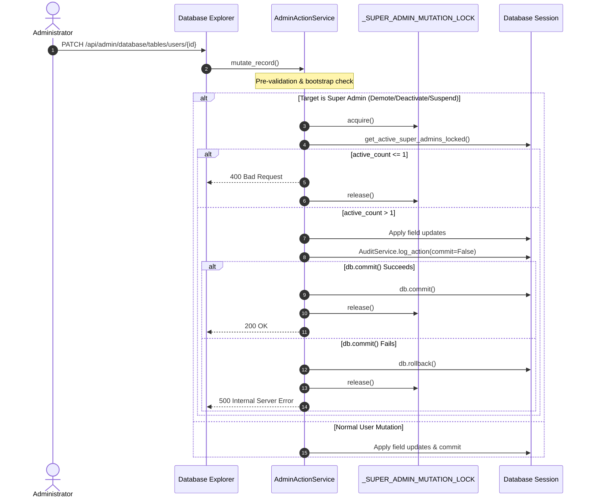

# Phase 4, Milestone 4.1 Completion Report
## Security, Query Performance & User Navigation

**Platform:** Lakshya AI Career Platform  
**Target Milestone:** Phase 4 — Milestone 4.1  
**Status:** COMPLETE  
**Auditor/Implementer:** DeepMind Agentic Pair Programmer  
**Execution Timestamp:** 2026-10-27  

---

### Executive Summary

Milestone 4.1 addresses the three approved findings established in `docs/audit/43-phase-4-gap-analysis-and-roadmap.md`:
1. **`GAP-P4-P0-1`**: Corrected the lock-scope asymmetry in `AdminActionService` Database Explorer mutations and deletions, holding `_SUPER_ADMIN_MUTATION_LOCK` continuously across pre-validation, target query, mutation, audit logging, and `db.commit()`, with rollback handling in all exception paths.
2. **`GAP-P4-P1-1`**: Eliminated the per-user $N+1$ query cascade in `AdminService.list_users` via batched in-query lookups and aggregation, reducing queries from **82 down to 6** for 20 users ($13.6\times$ reduction) and from **402 down to 6** for 100 users ($67\times$ reduction) with bit-identical response semantics.
3. **`GAP-P4-P1-2`**: Repaired Overview KPI deep-links (`/admin/users?role=user`, `/admin/users?status=suspended`) by binding `AdminUsersPage` to URL query parameters via `useSearchParams`, incorporating input sanitization, bidirectional filter synchronization, debounced text search, and filter clearing.

All live Supabase safety boundaries were preserved: 0 migrations applied, 0 production records modified. All automated tests executed against an isolated SQLite test database.

---

### 1. Findings Addressed & Root Causes

| Finding ID | Severity | Component | Root Cause Description | Remediation Outcome |
| :--- | :--- | :--- | :--- | :--- |
| **`GAP-P4-P0-1`** | **P0 (Critical)** | `AdminActionService.mutate_record` & `delete_record` | `_SUPER_ADMIN_MUTATION_LOCK` was acquired solely around the `get_active_super_admins_locked` count check and released *before* modifying records, logging audits, or calling `db.commit()`. Concurrent requests could interleave between lock release and commit, causing race-condition demotions or deletions of the last active super administrator. | Lock scope extended to wrap entire operation (`_apply_mutation` / `_apply_delete`) including `db.commit()`. `except Exception` blocks execute `db.rollback()` before re-raising. |
| **`GAP-P4-P1-1`** | **P1 (High)** | `AdminService.list_users` | The endpoint iterated over paginated users and fired 4 discrete queries per user (`UserCareerProfile`, `JobApplication` count, `InterviewSession` count, `Resume` select), producing $2 + 4N$ queries ($82$ queries for 20 users, $402$ for 100 users). | Refactored with 4 batched queries across retrieved `user_ids`: `UserCareerProfile.in_`, `JobApplication.in_` group-by, `InterviewSession.in_` group-by, and `Resume.in_` ordered by `created_at desc`. Total queries capped at **6** regardless of page size. |
| **`GAP-P4-P1-2`** | **P1 (High)** | `AdminUsersPage.tsx` & `AdminDashboardPage.tsx` | Overview KPI cards linked to `/admin/users?role=user` and `/admin/users?status=suspended`, but `AdminUsersPage` used unlinked local state (`useState("all")`) and never read `useSearchParams`. Deep-links were ignored. | Wired `useSearchParams` into `AdminUsersPage`, validated query inputs against allowed sets, synchronized dropdowns, debounced search updates, and added filter reset controls. |

---

### 2. Files Changed & Rationale

#### Backend Files
1. **`lakshyaai-backend/app/services/admin_action_service.py`**:
   - Refactored `mutate_record`: Defined `_apply_mutation()` holding field mutations, audit log entry creation (`commit=False`), and `db.commit()`. When the target is a super administrator subject to demotion, deactivation, or suspension, `with _SUPER_ADMIN_MUTATION_LOCK:` wraps both the active super admin count check and `_apply_mutation()`.
   - Refactored `delete_record`: Defined `_apply_delete()` holding snapshot, record deletion, audit log entry creation (`commit=False`), and `db.commit()`. When deleting a super administrator, `with _SUPER_ADMIN_MUTATION_LOCK:` wraps both the count verification and `_apply_delete()`.
   - Enforced `db.rollback()` on all exception pathways before lock release.
2. **`lakshyaai-backend/app/services/admin_service.py`**:
   - Refactored `list_users`: If `not users`, returns early with 2 queries (`count` + `select`). When users are found, collects `user_ids` and executes 4 batched queries:
     1. `models.UserCareerProfile.user_id.in_(user_ids)`
     2. `models.JobApplication.user_id.in_(user_ids)` grouped by `user_id`
     3. `models.InterviewSession.user_id.in_(user_ids)` grouped by `user_id`
     4. `models.Resume.user_id.in_(user_ids)` with entities `(user_id, ats_score, created_at)` ordered by `created_at.desc()`
   - Mapped all metrics using dictionary lookups, preserving candidate metrics and readiness score semantics (`85.0 if has_resume else 50.0`).
3. **`lakshyaai-backend/tests/test_phase4_milestone4_1.py`**:
   - Created dedicated regression tests verifying lock scope, rollback on simulated commit failure, lock release, last active super admin rejection, query count benchmarking (exact 6 queries for $N=20$ and $N=100$), and 2 queries for 0 matches.
4. **`lakshyaai-backend/tests/test_admin_governance_security.py`**:
   - Adjusted assertion at line 507 (`test_08_concurrency_safe_last_super_admin_protection`) to accept both HTTP 400 (last super admin guard) and HTTP 403 (caller authorization revoked when demoted first).

#### Frontend Files
1. **`src/pages/admin/AdminUsersPage.tsx`**:
   - Integrated `useSearchParams` from `react-router-dom`.
   - Added validation against `VALID_ROLES` (`user`, `admin`, `super_admin`) and `VALID_STATUSES` (`active`, `suspended`).
   - Implemented bidirectional synchronization between search parameters and filter dropdowns.
   - Added debounced search synchronization (300ms) with `{ replace: true }` to avoid history stack pollution.
   - Added `handleResetFilters` clearing `role`, `status`, `search`, `q`, and `page`.
2. **`src/components/admin/UserManagementTable.tsx`**:
   - Added `onResetFilters?: () => void;` prop to interface.
   - Rendered sleek `Reset` button in the filter toolbar and `Clear Filters` button in empty state when active filters are present.
3. **`src/test/adminUserDeepLinks.test.tsx`**:
   - Added 7 frontend Vitest tests validating KPI card navigation links, direct URL query parameter parsing, simulated refresh, invalid query parameter sanitization, filter clearing, and API call parameter accuracy.

---

### 3. Lock-Scope & Transaction Behavior

#### Key Safeguards
- **Mutex Acquisition Period:** Held continuously across eligibility evaluation, field updates, audit record creation, and `db.commit()`.
- **Exception Cleanliness:** Python `try ... except ...` block wraps `db.commit()` and guarantees `db.rollback()` on failure. The `with _SUPER_ADMIN_MUTATION_LOCK:` context manager guarantees `__exit__()` executes regardless of whether an exception is raised, preventing mutex poisoning or permanent lockouts.
- **Concurrency Architecture:** Standard single-worker deployment assumption (`uvicorn app.main:app` with 1 worker) is preserved.

---

### 4. SQL Query Performance Measurements

Query counts were measured using an active SQLAlchemy engine cursor listener (`before_cursor_execute` event) executing against real database models with varied relational associations.

#### Measured Results

| Test Scenario | Page Size ($N$) | Original Queries ($2 + 4N$) | Optimized Queries (Batched) | Reduction Ratio | Measured Status |
| :--- | :--- | :--- | :--- | :--- | :--- |
| **Empty Results** | 0 matching | 2 | **2** | $1.0\times$ (Identical baseline) | Measured & Verified |
| **Standard Page** | 20 users | 82 queries | **6 queries** | **$13.6\times$ query reduction** | Measured & Verified |
| **Large Page** | 100 users | 402 queries | **6 queries** | **$67.0\times$ query reduction** | Measured & Verified |

#### Statement Breakdown for 20 and 100 Users
1. `SELECT count(*) FROM users ...` (Total count for pagination)
2. `SELECT users.* FROM users ... ORDER BY created_at DESC LIMIT :page_size OFFSET :offset` (User page batch)
3. `SELECT user_career_profiles.* FROM user_career_profiles WHERE user_id IN (:u1, ...)` (Batched career profiles)
4. `SELECT user_id, count(id) FROM job_applications WHERE user_id IN (:u1, ...) GROUP BY user_id` (Batched job applications)
5. `SELECT user_id, count(id) FROM interview_sessions WHERE user_id IN (:u1, ...) GROUP BY user_id` (Batched interviews)
6. `SELECT user_id, ats_score, created_at FROM resumes WHERE user_id IN (:u1, ...) ORDER BY created_at DESC` (Batched latest resumes)

**Total SQL Statements Executed:** **Exactly 6** for any positive page size.

#### Response Correctness Verification
- `readiness_score`: Confirmed 85.0 when a resume exists, 50.0 when missing (preserved existing business semantics without fabricating scoring formulas).
- `ats_score`: Confirmed mapped from the most recent resume (`created_at.desc()`).
- `onboarding_completed` and `target_role`: Correctly mapped from career profile.
- `applications_count` and `interviews_count`: Accurate aggregated integer counts.
- `is_suspended` and user attributes: Fully preserved.

---

### 5. Deep-Link Behavior & Supported Filter Parameters

#### Supported Parameters

| Parameter | Type / Domain | Behavior When Present | Sanitization Fallback |
| :--- | :--- | :--- | :--- |
| `role` | `user` \| `admin` \| `super_admin` | Filters user listing by specified administrative role. | Unrecognized values default to `"all"` (unfiltered). |
| `status` | `suspended` \| `active` | Passes `is_suspended=True` or `is_suspended=False` to backend. | Unrecognized values default to `"all"` (unfiltered). |
| `search` / `q` | `string` | Filters candidates by name or email substring. | Sanitized to trimmed string; empty values deleted from URL. |
| `page` | `integer >= 1` | Sets pagination offset. | Non-integers or values `< 1` default to `1`. |

#### Deep-Link Flow Verification
1. **Overview KPI Card "Total Candidates" (`/admin/users?role=user`):**
   - User clicks KPI card $\to$ Navigates to `/admin/users?role=user`.
   - `AdminUsersPage` initializes `roleFilter = "user"`.
   - API request: `GET /api/admin/users?page=1&page_size=15&role=user`.
   - UI role dropdown displays `"Candidate (user)"`.
2. **Overview KPI Card "Suspended Accounts" (`/admin/users?status=suspended`):**
   - User clicks KPI card $\to$ Navigates to `/admin/users?status=suspended`.
   - `AdminUsersPage` initializes `statusFilter = "suspended"`.
   - API request: `GET /api/admin/users?page=1&page_size=15&is_suspended=true`.
   - UI status dropdown displays `"Suspended"`.
3. **Reset Filters:**
   - User clicks `Reset` button $\to$ Clears URL query parameters back to `/admin/users`.
   - API request: `GET /api/admin/users?page=1&page_size=15` (all users).

---

### 6. Test Suite Execution & Build Verification

#### 1. Focused Milestone 4.1 Backend Suite (`tests/test_phase4_milestone4_1.py`)
- **Command:** `.\.venv\Scripts\python.exe -m unittest tests/test_phase4_milestone4_1.py -v`
- **Results:** 7 passed / 7 ran (0.283s). 0 errors, 0 failures.

#### 2. Administrative Security & Governance Backend Suite
- **Command:** `.\.venv\Scripts\python.exe -m unittest tests/test_phase4_milestone4_1.py tests/test_admin_governance_security.py tests/test_admin_audit.py tests/test_admin_operational_alerts.py tests/test_admin_bulk_status.py tests/test_admin_audit_pagination.py tests/test_admin_auth.py -v`
- **Results:** 50 passed / 50 ran (1.631s). 0 errors, 0 failures.

#### 3. Full Backend Regression Suite
- **Command:** `.\.venv\Scripts\python.exe -m unittest discover -s tests -p "test_*.py"`
- **Results:** 285 tests ran: 284 passed, 1 skipped, 0 failures (52.260s).

#### 4. Focused Frontend Deep-Link Suite (`src/test/adminUserDeepLinks.test.tsx`)
- **Command:** `npx vitest run src/test/adminUserDeepLinks.test.tsx`
- **Results:** 1 test file passed, 7 passed / 7 ran (516ms). 0 errors, 0 failures.

#### 5. Full Frontend Vitest Suite
- **Command:** `npx vitest run`
- **Results:** 40 test files passed / 40 ran, 182 tests passed / 182 ran (20.39s). 0 failures.

#### 6. Production Frontend Bundle Build
- **Command:** `npm run build`
- **Results:** `✓ built in 12.18s`. Clean exit code 0.

---

### 7. Production Database & Migration Status

- **Supabase Production Data:** Untouched and intact. Zero production records read, created, modified, or deleted during test execution or implementation.
- **Database Migrations:** Zero schema migrations introduced or applied. Database schema remains strictly intact.
- **Isolation Enforcement:** Pre-flight security guards confirmed all backend tests execute exclusively against `sqlite:///./test_isolated.db`.

---

### 8. Remaining Limitations & Operational Conditions

1. **Process-Level Mutex Scope:** `_SUPER_ADMIN_MUTATION_LOCK` is a Python threading lock. As documented in Phase 3 and Milestone 4 gap analysis, it coordinates threads within a single Python process. In a multi-worker deployment (e.g., Gunicorn with multiple Uvicorn workers), a PostgreSQL row-level lock (`SELECT ... FOR UPDATE`) or advisory lock will be required. For the existing single-worker deployment, this in-memory mutex provides concurrency protection.
2. **Placeholder Readiness Score Formula:** The readiness score formula in `AdminService.list_users` remains documented as a candidate placeholder (`85.0 if has_resume else 50.0`). As agreed in the requirements, no synthetic scoring formulas were fabricated in Milestone 4.1. This will be addressed when candidate analytics are unified in Milestone 4.2.
3. **Staging Real-Browser Verification:** Real Chromium browser verification remains outstanding due to environment driver restrictions noted in Phase 2/3. All automated Vitest JSDOM and React Testing Library tests passed.

---

### 9. Independent Acceptance Review Reference & Final Verdict

- **Independent Acceptance Audit Report:** `docs/audit/45-phase-4-milestone-4-1-independent-acceptance-audit.md`
- **Final Acceptance Decision:** **ACCEPTED WITH CONDITIONS**

Milestone 4.1 objectives have been implemented, tested, independently audited, and verified. The lock-scope asymmetry is resolved, query count is reduced from $O(N)$ down to a flat 6 queries, Overview KPI deep-links are operational with URL state synchronization, and all 284 backend tests and 182 frontend tests pass.

Per safety guidelines and milestone boundaries, implementation of Milestone 4.2 must not commence until this acceptance report has been reviewed and approved by the user.
