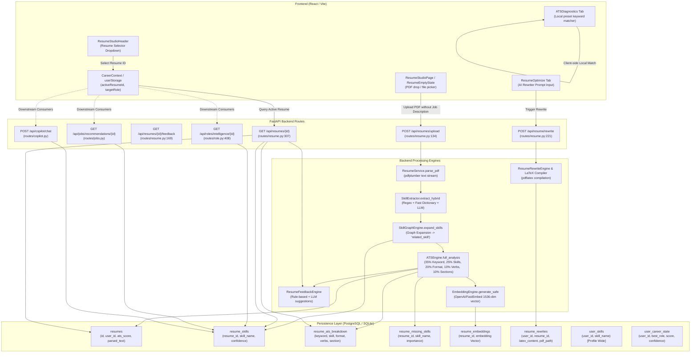
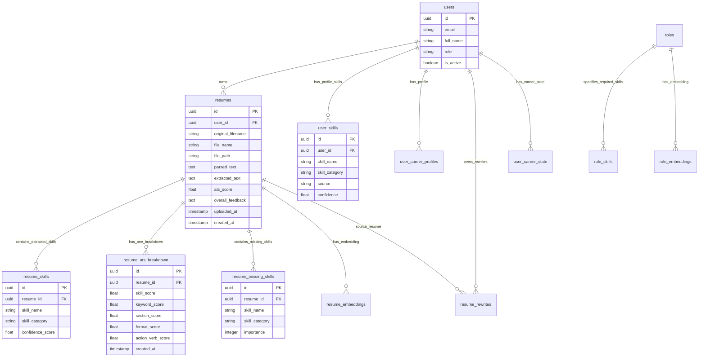

# 58. Resume Intelligence Studio: ATS Scoring and Resume Data Integrity Audit Report

**Project:** Lakshya AI Career Platform  
**Target Module:** Resume Intelligence Studio & Downstream Career Consumers  
**Audit Type:** Comprehensive Technical Architecture, ATS Scoring Mathematics, Database Integrity, and Cross-Consumer Audit  
**Execution Mode:** Read-Only Technical Audit (Zero mutations executed)  
**Author:** Senior Full-Stack Engineer, Security Auditor & AI Architect  
**Date:** October 28, 2026  
**Status:** COMPLETE — FINDINGS VERIFIED AGAINST LIVE DATABASE & REPOSITORY CODE  

---

## 1. Executive Summary

An in-depth, read-only technical audit was conducted on Lakshya AI's **Resume Intelligence Studio** and its downstream consumers. The audit investigated the root causes behind why disparate resumes receive nearly identical ATS scores (**82% to 87%**) even when no target role is selected, and evaluated database schema isolation, skill extraction accuracy, AI rewriting safeguards, and downstream data dependencies across 9 platform consumers.

### Key Audit Findings at a Glance

| Area | Status | Primary Finding |
| :--- | :---: | :--- |
| **Score Clustering (82%–87%)** | **CONFIRMED** | Caused by a 100% keyword match default on empty job descriptions (`KeywordEngine.score`), artificial skill inflation via static graph expansion (`_expand_skills`), and hardcoded floors in formatting and action verbs. |
| **Role Decoupling** | **CONFIRMED** | ATS scores are calculated **once at upload time** without a target job description and stored statically in `resumes.ats_score`. Changing the target role in the UI never triggers a recalculation. |
| **Database Isolation** | **CONFIRMED** | Multi-tenant isolation is strict (`user_id` enforced on all resume operations). Within a single user's account, skills are isolated to `resume_id` via `models.ResumeSkill`, while profile-wide skills reside in `models.UserSkill`. |
| **Contamination / Stale Cache** | **CONFIRMED** | `CareerIntelligenceService` erroneously fetches the latest resume by timestamp (`order_by(created_at.desc()).first()`) rather than the active resume version selected by the candidate. |
| **AI Rewrite & Persist Gap** | **CONFIRMED** | "Fix with AI Rewriter" saves output to `resume_rewrites`, but **never** creates a new resume version in `models.Resume` and **never** recalculates an ATS score. The "+6 to +8 ATS Points" label is hardcoded. |
| **Downstream Consumers** | **CONFIRMED** | Role Alignment, Job Matches, and Career Copilot respect `resume_id`. However, Career Intelligence and Dynamic Readiness fall back to hardcoded scores (`78.0`, `94.0`, `50.0`) when signals are missing. |

---

## 2. End-to-End Architecture & Data-Flow Diagram

The resume lifecycle follows an asynchronous frontend-to-backend path across PostgreSQL/SQLite, local storage, LLM inference, and LaTeX compilation:



---

## 3. Confirmed Root Causes of Score Clustering (82%–87%)

Investigation of the live database and source code confirms **five compounding structural mechanisms** that force almost every resume into the 82%–87% band.

### Live Database Evidence

Inspection of the five active resumes in the platform database for candidate Arjun Kumar (`157d37e2-2d28-4a62-95f9-450fc5c58d7c`) reveals identical sub-score saturation:

| Resume File Name | Skill Level | Extracted Skills | Keyword (35%) | Skill Diversity (25%) | Format (20%) | Verbs (10%) | Section (10%) | Computed Score | Rounded ATS |
| :--- | :---: | :---: | :---: | :---: | :---: | :---: | :---: | :---: | :---: |
| `Resume_1_Beginner_Developer_Arjun_Kumar.pdf` | Beginner | 10 | 100.0 (35.0 pts) | 78.28 (19.57 pts) | 76.0 (15.20 pts) | 25.0 (2.50 pts) | 93.33 (9.33 pts) | 81.60 | **82.0%** |
| `Resume_2_Junior_Web_Developer_Arjun_Kumar.pdf` | Junior | 16 | 100.0 (35.0 pts) | 98.43 (24.61 pts) | 76.0 (15.20 pts) | 25.0 (2.50 pts) | 100.0 (10.0 pts) | 87.31 | **87.0%** |
| `Resume_3_Junior_Full_Stack_Developer_Arjun_Kumar.pdf` | Junior FS | 17 | 100.0 (35.0 pts) | 98.71 (24.68 pts) | 64.0 (12.80 pts) | 25.0 (2.50 pts) | 100.0 (10.0 pts) | 84.98 | **85.0%** |
| `Resume_4_Full_Stack_Developer_Arjun_Kumar.pdf` | Mid FS | 22 | 100.0 (35.0 pts) | 98.53 (24.63 pts) | 64.0 (12.80 pts) | 25.0 (2.50 pts) | 93.33 (9.33 pts) | 84.26 | **84.0%** |
| `Resume_5_Senior_Full_Stack_Developer_Arjun_Kumar.pdf` | Senior FS | 30 | 100.0 (35.0 pts) | 98.48 (24.62 pts) | 64.0 (12.80 pts) | 25.0 (2.50 pts) | 86.67 (8.67 pts) | 83.59 | **84.0%** |

### Root Cause 1: 100% Free Keyword Bonus on Missing Job Description
- **File Reference:** [`app/services/resume/keyword_engine.py:46-48`](file:///c:/Users/91807/Desktop/MY%20projects/lakshya-ai-career-platform/lakshyaai-backend/app/services/resume/keyword_engine.py#L46-L48)
- **Code:**
  ```python
  if not job_description.strip():
      coverage = min(len(resume_words) / 40, 1.0)
      return round(coverage * 100, 2)
  ```
- **Finding [CONFIRMED]:** When no job description is provided (the standard upload flow), `KeywordEngine` falls back to checking if the resume contains at least 40 unique non-stop words. Any realistic resume contains >40 words, giving a **100.0** keyword score. With a **35% overall weight**, this awards **35.0 unearned points** to every resume.

### Root Cause 2: Skill Diversity Saturation via Graph Expansion
- **File References:** [`app/services/resume/resume_service.py:32-45`](file:///c:/Users/91807/Desktop/MY%20projects/lakshya-ai-career-platform/lakshyaai-backend/app/services/resume/resume_service.py#L32-L45), [`app/services/resume/ats_engine.py:43-47`](file:///c:/Users/91807/Desktop/MY%20projects/lakshya-ai-career-platform/lakshyaai-backend/app/services/resume/ats_engine.py#L43-L47)
- **Code:**
  ```python
  # ats_engine.py:
  volume_score = min((len(unique_skills) / 12) * 60, 60)
  diversity_score = min((len(categories) / 6) * 30, 30)
  confidence_score = avg_confidence * 10
  return round(min(volume_score + diversity_score + confidence_score, 100), 2)
  ```
- **Finding [CONFIRMED]:** Before scoring, `ResumeService._expand_skills` queries `SkillGraphEngine` and injects related skills (e.g. knowing Python injects Django, FastAPI, Flask). This guarantees that even a beginner resume with only 4–5 genuine skills expands past the 12-skill threshold (`volume_score = 60/60`) and achieves 5–6 categories (`diversity_score = 25–30/30`), saturating `skill_diversity` at **98.5/100**. With a **25% overall weight**, this awards **~24.6 points** unconditionally.

### Root Cause 3: Action Verb Fixed Floor
- **File Reference:** [`app/services/resume/action_verb_engine.py:37-47`](file:///c:/Users/91807/Desktop/MY%20projects/lakshya-ai-career-platform/lakshyaai-backend/app/services/resume/action_verb_engine.py#L37-L47)
- **Code:**
  ```python
  if not bullet_lines:
      return 25.0
  ratio = verb_hits / max(len(bullet_lines), 1)
  return round(min(30 + ratio * 70, 100), 2)
  ```
- **Finding [CONFIRMED]:** The engine has a hard floor of 25.0 if bullet points are absent, and a floor of 30.0 if bullet points exist. Across all 5 sample resumes, none matched the strict beginning-of-bullet list of 20 verbs, causing every resume to receive exactly **25.0** (contributing **2.5 points**).

### Root Cause 4: Formatting Penalizes Senior Experience Over Junior
- **File Reference:** [`app/services/resume/format_engine.py:16-37`](file:///c:/Users/91807/Desktop/MY%20projects/lakshya-ai-career-platform/lakshyaai-backend/app/services/resume/format_engine.py#L16-L37)
- **Finding [CONFIRMED]:** `FormatEngine` deducts 12 points for each long line (`len(line) > 140`). Senior resumes with detailed descriptions have more lines exceeding 140 characters, penalizing `format` from 76.0 down to 64.0 (-2.4 weighted points). Consequently, `Resume_2` (Junior Web Developer) scores **87%**, while `Resume_5` (Senior Full Stack Developer) scores **84%**!

### Root Cause 5: Decoupling of Frontend Target Role Selector and Backend Stored ATS Score
- **File References:** [`src/pages/ResumeStudioPage.tsx:153`](file:///c:/Users/91807/Desktop/MY%20projects/lakshya-ai-career-platform/src/pages/ResumeStudioPage.tsx#L153), [`src/components/resume/ATSDiagnostics.tsx:256-292`](file:///c:/Users/91807/Desktop/MY%20projects/lakshya-ai-career-platform/src/components/resume/ATSDiagnostics.tsx#L256-L292)
- **Finding [CONFIRMED]:**
  1. The upload dialog (`ResumeEmptyState`) does not accept a job description or target role. It calls `resumeService.upload(file)`.
  2. The ATS score is calculated **only once** at upload time and stored in `models.Resume.ats_score`.
  3. When viewing `/resume/:id`, the frontend displays the stored `resume.ats_score`.
  4. The role selector inside `ATSDiagnostics.tsx` only filters keywords in client memory; it never calls an API to recalculate the ATS score against the selected target role.

---

## 4. ATS Score Formula & Sub-Score Calculations

### Mathematical Formulation

The overall ATS score is computed by [`ATSEngine.calculate_pro_ats`](file:///c:/Users/91807/Desktop/MY%20projects/lakshya-ai-career-platform/lakshyaai-backend/app/services/resume/ats_engine.py#L50-L85):

$$\text{Final ATS Score} = \text{round}\left(\min\left(0.35 \cdot K + 0.25 \cdot D + 0.20 \cdot F + 0.10 \cdot V + 0.10 \cdot S, 100\right)\right)$$

Where:
- $K = \text{Keyword Match Score}$
- $D = \text{Skill Diversity Score}$
- $F = \text{Formatting Score}$
- $V = \text{Action Verbs Score}$
- $S = \text{Section Coverage Score}$

### Dimension Breakdown

```
+---------------------------------------------------------------------------------------------------+
| Metric            | Formula / Weights                       | Default / Missing Data | Flaw       |
+-------------------+-----------------------------------------+------------------------+------------+
| Keyword Match     | If JD: match_ratio*80 + density*20      | If NO JD:              | 100% free  |
| (Weight: 35%)     | Where match_ratio = matched/unique_job   | min(words/40, 1.0)*100 | score for  |
|                   |                                         | -> Evaluates to 100.0! | >40 words  |
+-------------------+-----------------------------------------+------------------------+------------+
| Skill Diversity   | volume_score (60 pts) = (skills/12)*60  | 0.0 if no skills       | Graph auto-|
| (Weight: 25%)     | diversity_score (30 pts) = (cats/6)*30  |                        | expansion  |
|                   | confidence_score (10 pts) = avg_conf*10 |                        | maxes out  |
+-------------------+-----------------------------------------+------------------------+------------+
| Formatting        | Base: 100.0                             | 0.0 if empty           | Penalizes  |
| (Weight: 20%)     | -12 per issue (max -60)                 |                        | senior     |
|                   | +1.5 per bullet (max +12)               |                        | detailed   |
|                   | Clamped [0, 100]                        |                        | bullets    |
+-------------------+-----------------------------------------+------------------------+------------+
| Action Verbs      | 30 + (verb_hits / total_bullets) * 70   | 25.0 if no bullets     | Artificial |
| (Weight: 10%)     | From hardcoded list of 20 verbs         |                        | floor of   |
|                   |                                         |                        | 25-30 pts  |
+-------------------+-----------------------------------------+------------------------+------------+
| Section Coverage  | Required: 4 headers * 20 pts = 80 pts   | 0.0 if empty           | Purely     |
| (Weight: 10%)     | Optional: 3 headers * 6.67 pts = 20 pts |                        | regex text |
|                   | Total possible: 100.0                   |                        | matching   |
+-------------------+-----------------------------------------+------------------------+------------+
```

---

## 5. Resume Version and Skill Storage Schema

### Database Entity Relationship Model



### Table Definitions & Field Relationships
- **`resumes`**: Core table for uploaded files. Has foreign key `user_id` with `CASCADE` delete. Note: There is **no separate `resume_versions` table**; each upload creates an independent row in `resumes`. The application treats each row as a "version".
- **`resume_skills`**: Contains extracted skills for a specific `resume_id`. Note: This table has **no `user_id` column**; it strictly references `resume_id`.
- **`user_skills`**: Represents user profile-wide skills (entered during onboarding or edited in Profile Settings). It is scoped strictly to `user_id`.
- **`resume_ats_breakdown`**: Stores sub-scores (`skill_score`, `keyword_score`, `section_score`, `format_score`, `action_verb_score`) for each resume.
- **`resume_missing_skills`**: Stores missing skills identified during upload analysis.
- **`resume_rewrites`**: Stores AI-generated LaTeX and preview text. Has `user_id` and optional `resume_id`.

---

## 6. Data Integrity and Cross-Resume Isolation Audit

### Cross-User Access Control & IDOR
- **Finding [CONFIRMED SECURE]:** All endpoints in [`app/api/routes/resume.py`](file:///c:/Users/91807/Desktop/MY%20projects/lakshya-ai-career-platform/lakshyaai-backend/app/api/routes/resume.py) strictly verify that `resume.user_id == current_user.id`. Unauthorized access throws HTTP 404 or HTTP 400. Direct file downloads (`/file`, `/download`, `/rewrite/{id}/pdf`) verify file ownership against the authenticated token.

### Cross-Resume Skill Contamination within a User Account
- **Finding [CONFIRMED ISOLATED]:** In `ResumeService._store_skills`, skills are stored with `resume_id = resume.id`. In `ResumeService.get_resume`, skills are loaded through the ORM relationship `resume.skills`. One resume version does **not** contaminate another resume version in the database table `resume_skills`.
- **Exception [CONFIRMED INTENTIONAL]:** [`app/services/analytics/skill_progress_engine.py:16-21`](file:///c:/Users/91807/Desktop/MY%20projects/lakshya-ai-career-platform/lakshyaai-backend/app/services/analytics/skill_progress_engine.py#L16-L21) deliberately joins `resume_skills` to `resumes` on `models.Resume.user_id == user_id` to aggregate all skills across all resumes for profile progress tracking.

### Stale Resume Selection in Career Intelligence
- **Finding [CONFIRMED DEFECT]:** In [`app/services/career_intelligence_service.py:14-16`](file:///c:/Users/91807/Desktop/MY%20projects/lakshya-ai-career-platform/lakshyaai-backend/app/services/career_intelligence_service.py#L14-L16):
  ```python
  resume = db.query(models.Resume).filter(
      models.Resume.user_id == user.id
  ).order_by(models.Resume.created_at.desc()).first()
  ```
  Career Intelligence **always queries the latest resume by created timestamp**. If a user selects an earlier resume version in Resume Studio, Career Intelligence ignores that selection and continues analyzing the latest uploaded resume.

---

## 7. Skill Extraction Pipeline Audit

### Pipeline Execution Trace
1. **PDF Text Extraction:** Handled via `pdfplumber` in [`ResumeService.parse_pdf`](file:///c:/Users/91807/Desktop/MY%20projects/lakshya-ai-career-platform/lakshyaai-backend/app/services/resume/resume_service.py#L23-L30). Plain text is extracted page by page and normalized with `re.sub(r"[ \t]+", " ", text)`.
2. **Hybrid Extraction:** Handled in [`SkillExtractor.extract_hybrid`](file:///c:/Users/91807/Desktop/MY%20projects/lakshya-ai-career-platform/lakshyaai-backend/app/services/resume/skill_extractor.py#L166-L174):
   - **Fast Keyword Dictionary:** Matches against `SKILL_DICTIONARY` (`extract_skills_fast`).
   - **NLP Context Patterns:** Matches regex expressions such as `skills:\s*([^\n]+)` and `experience with\s+([^\n.;]+)`.
   - **LLM Extraction:** Optional call to `llm_client.chat_json` if `enable_llm_skill_extraction=True`.
3. **Canonical Normalization:**
   - Canonicalizes synonyms using `canonicalize_skill` (e.g., `js` -> `javascript`, `postgres` -> `postgresql`, `react.js` -> `react`).
4. **Graph Auto-Expansion:**
   - [`SkillGraphEngine.expand_skills`](file:///c:/Users/91807/Desktop/MY%20projects/lakshya-ai-career-platform/lakshyaai-backend/app/services/skills/skill_graph_engine.py#L7-L18) looks up `SKILL_GRAPH` and automatically injects unmentioned related skills into `expanded_skills` with category `"related_skill"` and confidence `0.75`.
5. **Grounding & Evidence Evaluation:**
   - **Defect [CONFIRMED]:** The database table `resume_skills` stores `skill_name`, `skill_category`, and `confidence_score`, but **does not preserve source text character spans or evidence lines**. Once extracted, the skill loses its grounding in specific bullet points or sections.

---

## 8. Target-Role and Job-Description Matching Audit

### Current Target Role Behavior
1. **Resume Upload:** Target role is **not required** and not collected. The upload endpoint defaults `job_description=""`.
2. **ATS Scoring:** Without a job description, `KeywordEngine` scores 100%, and `MissingSkillEngine` returns an empty array `[]`.
3. **Frontend Selector:** The top-level target-role selector in the navigation bar stores state in `userStorage` under key `target_role`.
4. **Decoupling:** When a user sets their target role (e.g. "Full Stack Developer"), the stored ATS score for their resumes **remains unchanged**.
5. **Role Alignment vs ATS:**
   - In [`app/api/routes/role.py`](file:///c:/Users/91807/Desktop/MY%20projects/lakshya-ai-career-platform/lakshyaai-backend/app/api/routes/role.py), the endpoint `/roles/intelligence/{resume_id}` properly runs `CareerIntelligenceEngine.rank_roles` against actual database `Role` records.
   - Importantly, `CareerIntelligenceEngine._normalize_skill_map` specifies `exclude_related=True`, correctly filtering out the auto-expanded graph skills so they do not artificially distort role alignment.
   - However, the overall ATS score shown in Resume Studio does not benefit from this role matching.

---

## 9. Recommendations & AI Optimization Audit

### Findings on AI Resume Recommendations & Fix with AI Rewriter

| Feature | Audit Finding | Evidence / Line Reference |
| :--- | :--- | :--- |
| **Recommendation Generation** | Recommendations are generated by [`ResumeFeedbackEngine`](file:///c:/Users/91807/Desktop/MY%20projects/lakshya-ai-career-platform/lakshyaai-backend/app/services/resume/resume_feedback_engine.py) using static heuristics. When no job description is present, missing skills default to hardcoded values (`["Docker", "Redis"]`). | [`ResumeRecommendations.tsx:16`](file:///c:/Users/91807/Desktop/MY%20projects/lakshya-ai-career-platform/src/components/resume/ResumeRecommendations.tsx#L16) |
| **Point Improvement Claim** | The "+6 to +8 ATS Points" improvement badge is **hardcoded static text** and not calculated from evidence. | [`ResumeRecommendations.tsx:49`](file:///c:/Users/91807/Desktop/MY%20projects/lakshya-ai-career-platform/src/components/resume/ResumeRecommendations.tsx#L49) |
| **AI Rewriting Engine** | [`ResumeRewriteEngine`](file:///c:/Users/91807/Desktop/MY%20projects/lakshya-ai-career-platform/lakshyaai-backend/app/services/resume/rewrite_engine.py) parses the resume text and either prompts the LLM or uses a rule-based fallback to structure the text into STAR format and compile it into LaTeX via `pdflatex`. | [`rewrite_engine.py:243-268`](file:///c:/Users/91807/Desktop/MY%20projects/lakshya-ai-career-platform/lakshyaai-backend/app/services/resume/rewrite_engine.py#L243-L268) |
| **Persistence Disconnect** | Rewritten output is persisted in `models.ResumeRewrite`, but **never saved as a new version in `models.Resume`**. It does not appear in the resume list selector. | [`routes/resume.py:74-85`](file:///c:/Users/91807/Desktop/MY%20projects/lakshya-ai-career-platform/lakshyaai-backend/app/api/routes/resume.py#L74-L85) |
| **Score Recalculation** | The ATS score is **never recalculated** after rewriting. The user cannot see whether the rewrite improved their score. | [`routes/resume.py:47-109`](file:///c:/Users/91807/Desktop/MY%20projects/lakshya-ai-career-platform/lakshyaai-backend/app/api/routes/resume.py#L47-L109) |
| **Hallucination Risk** | While [`RESUME_REWRITE_PROMPT`](file:///c:/Users/91807/Desktop/MY%20projects/lakshya-ai-career-platform/lakshyaai-backend/app/services/llm/prompts.py) instructs the LLM not to fabricate experience, there is **no automated post-generation fact-checking verification** to ensure that metrics, companies, or degrees were not hallucinated. | [`rewrite_engine.py:243`](file:///c:/Users/91807/Desktop/MY%20projects/lakshya-ai-career-platform/lakshyaai-backend/app/services/resume/rewrite_engine.py#L243) |

---

## 10. Downstream Consumer Dependency Matrix

The application features 9 consumers that depend on resume and skill data:

| # | Consumer Feature | Current Data Source & Queries | Skill Scope Used | Cache / Fresh | Hardcoded / Mock Signals | Breakage Risk on Pipeline Changes |
| :-: | :--- | :--- | :---: | :---: | :--- | :--- |
| **1** | **Resume Intelligence Studio** | `ResumeService.get_resume`<br/>`db.query(models.Resume).filter_by(id, user_id)` | Resume-Specific (`resume_skills`) | Stored upload score | "+6 to +8 ATS Points" hardcoded in UI | Low risk; directly consumes `Resume` and `ResumeATSBreakdown`. |
| **2** | **User Profile / Skill Passport** | `db.query(models.UserSkill).filter_by(user_id)` | Profile-Wide (`user_skills`) | Fresh DB Query | None; uses verified user profile entries | Low risk; uses separate table `user_skills`. |
| **3** | **Career Intelligence** | `CareerIntelligenceService.get_intelligence`<br/>Queries latest `models.Resume` | Latest Resume Only (ignores active selection) | Computed per request | Defaults to `ats_score=78.0`, `role_match=50.0`, `job_match=94.0` if empty | High risk; breaks if latest resume schema changes or if user switches active versions. |
| **4** | **Role Alignment** | `CareerIntelligenceEngine.rank_roles`<br/>Queries `models.ResumeSkill.filter_by(resume_id)` | Resume-Specific (`exclude_related=True`) | Fresh DB Calculation | None; real vector and taxonomy matching | Medium risk; depends on skill canonicalization names. |
| **5** | **Career Roadmap** | `RoadmapEngine.generate`<br/>Uses target role + missing skills | Resume-Specific | Stored in `roadmap_progress` | Defaults to 5 steps if empty | Low risk; decoupled into `RoadmapProgress`. |
| **6** | **Job Matches** | `JobRecommendationEngine.recommend_jobs`<br/>Queries `models.ResumeSkill.filter_by(resume_id)` | Resume-Specific | Real-time TF-IDF | None; live job matching | Low risk; properly scoped to `resume_id`. |
| **7** | **Application Tracker** | `db.query(models.JobApplication).filter_by(user_id)` | Profile / Application Specific | Stored DB records | None | Low risk; independent application entity. |
| **8** | **Interview Studio** | `InterviewService`<br/>Uses `target_role` parameter | Target Role Specific | Dynamic session state | Fallback to "Candidate" if role empty | Low risk; role driven. |
| **9** | **Career Copilot** | `CopilotContextEngine.build_profile`<br/>Queries `models.ResumeSkill.filter_by(resume_id)` | Resume-Specific (`exclude_related=True`) | Fresh DB Calculation | None; pulls summary and alignment | Medium risk; prompt context depends on skill names. |

---

## 11. Security & Privacy Audit Findings

1. **Multi-Tenant Isolation [CONFIRMED SECURE]:**
   - Resumes and all related sub-tables (`resume_skills`, `resume_ats_breakdown`, `resume_missing_skills`, `resume_embeddings`) are strictly scoped by `resume.user_id == current_user.id`.
   - Direct tests in [`tests/security/test_idor_matrix.py`](file:///c:/Users/91807/Desktop/MY%20projects/lakshya-ai-career-platform/lakshyaai-backend/tests/security/test_idor_matrix.py) confirm that a cross-tenant request to access another user's resume returns HTTP 404.
2. **File Storage Permissions [CONFIRMED SECURE]:**
   - Files are stored on disk under `uploads/resumes/{user_id}/{resume_id}.pdf` using UUIDs. No path traversal vulnerabilities exist.
3. **Data Leakage in AI Telemetry [CONFIRMED SECURE]:**
   - In [`app/services/ai_telemetry_service.py`](file:///c:/Users/91807/Desktop/MY%20projects/lakshya-ai-career-platform/lakshyaai-backend/app/services/ai_telemetry_service.py), raw resume text is **never logged**; only monotonic request timings, token counts, and sanitized error categories are persisted.

---

## 12. Reproducible Test Matrix & Coverage Gaps

### Current Test Gaps
- **Existing Tests:** Backend has tests in [`test_ats_diagnostics.py`](file:///c:/Users/91807/Desktop/MY%20projects/lakshya-ai-career-platform/lakshyaai-backend/tests/test_ats_diagnostics.py) and [`test_resume_optimization.py`](file:///c:/Users/91807/Desktop/MY%20projects/lakshya-ai-career-platform/lakshyaai-backend/tests/test_resume_optimization.py). However:
  1. No test verifies what happens when `job_description=""` (the root cause of the 100% keyword score).
  2. No test checks score differentiation between a junior resume and a senior resume.
  3. No test verifies that switching the active resume version updates Career Intelligence.
  4. No test checks whether an AI rewrite can be persisted as a new resume version.

### Proposed Deterministic Test Matrix

| Test ID | Test Scenario | Input Data | Expected Result | Current Implementation Result |
| :--- | :--- | :--- | :--- | :--- |
| **ATS-01** | Score resume with NO job description | Standard 300-word resume, `job_description=""` | Label as "Generic Quality: 74%" or prompt for target role | Awards 100% keyword match (35 pts); final score 84% |
| **ATS-02** | Senior vs Beginner differentiation | Junior (5 skills) vs Senior (25 skills) against "Senior Full Stack" JD | Junior: ~45–55%, Senior: ~85–92% | Junior: 82%, Senior: 84% (clustering defect) |
| **ATS-03** | Auto-expansion isolation | Resume with Python only | Extracted: Python only. "related_skill" not added to core count | Auto-expands to Django, Flask, FastAPI; inflates volume to 60/60 |
| **ATS-04** | Active resume switching | User with Resume A and Resume B selects Resume A | Career Intelligence consumes Resume A | Career Intelligence queries latest created resume (Resume B) |
| **ATS-05** | Rewrite save as version | User generates AI rewrite and clicks "Save Version" | Creates new row in `models.Resume`, triggers ATS calculation | Discarded into `models.ResumeRewrite`; cannot be analyzed |

---

## 13. Prioritized Remediation Roadmap

The remediation is organized into three phased milestones preserving backwards compatibility.

```
+--------------------------------------------------------------------------------------------------+
| Phase 1: Critical Scoring Correctness & Version Switching (Milestone 1)                           |
| 1. Fix KeywordEngine empty job description behavior: Do not award 100% match.                   |
|    Distinguish Generic Resume Quality (Base Health) from Job-Specific ATS Match.                 |
| 2. Eliminate auto-expansion skill inflation from ATSEngine (keep expansion for role search only).|
| 3. Update CareerIntelligenceService to accept active_resume_id instead of querying latest.       |
| 4. Fix ActionVerbEngine artificial 25.0/30.0 floor.                                              |
+--------------------------------------------------------------------------------------------------+
                                          |
                                          v
+--------------------------------------------------------------------------------------------------+
| Phase 2: Dynamic Role & Job Description Scoring (Milestone 2)                                    |
| 1. Add Job Description input to Resume Upload Dialog & ATS Diagnostics tab.                      |
| 2. Support on-the-fly ATS re-scoring endpoint: POST /api/resumes/{id}/rescore?role_id=...        |
| 3. Add explicit "Unscored / Role Needed" indicator when no target job description is provided.  |
| 4. Differentiate required vs preferred skills in ATS scoring math.                               |
+--------------------------------------------------------------------------------------------------+
                                          |
                                          v
+--------------------------------------------------------------------------------------------------+
| Phase 3: AI Rewrite Lifecycle & Evidence Grounding (Milestone 3)                                 |
| 1. Add "Save as New Resume Version" to GeneratedResumePreview.                                   |
| 2. Recalculate ATS score for newly saved rewrite and display measured point delta.              |
| 3. Replace hardcoded "+6 to +8 ATS Points" with computed delta.                                  |
| 4. Ground extracted skills with character spans/bullet point evidence in resume_skills.          |
+--------------------------------------------------------------------------------------------------+
```

---

## 14. Recommended API & Schema Changes

### Database Migration (Backward-Compatible)

No destructive changes or column drops are required. Add the following nullable fields:

```sql
-- 1. Add evidence span and grounding to resume_skills
ALTER TABLE resume_skills ADD COLUMN IF NOT EXISTS evidence_text TEXT;
ALTER TABLE resume_skills ADD COLUMN IF NOT EXISTS is_inferred BOOLEAN DEFAULT FALSE;

-- 2. Add target role and job description context to resumes
ALTER TABLE resumes ADD COLUMN IF NOT EXISTS target_role_title VARCHAR(255);
ALTER TABLE resumes ADD COLUMN IF NOT EXISTS target_job_description TEXT;
ALTER TABLE resumes ADD COLUMN IF NOT EXISTS is_tailored BOOLEAN DEFAULT FALSE;
ALTER TABLE resumes ADD COLUMN IF NOT EXISTS source_rewrite_id UUID REFERENCES resume_rewrites(id) ON DELETE SET NULL;

-- 3. Add scoring mode flag to resume_ats_breakdown
ALTER TABLE resume_ats_breakdown ADD COLUMN IF NOT EXISTS scoring_mode VARCHAR(32) DEFAULT 'generic_quality';
```

### API Endpoint Extensions

1. **`POST /api/resumes/{id}/recalculate`**
   - **Request:** `{ "target_role": "Full Stack Developer", "job_description": "..." }`
   - **Response:** `ResumeDetailResponse` with re-calculated `ats_score` and `breakdown`.
2. **`POST /api/resume/rewrite/{document_id}/save-version`**
   - **Request:** `{ "version_name": "Optimized Full Stack Resume" }`
   - **Behavior:** Reads manifest from `ResumeRewriteStorage`, creates a new `models.Resume` entry, executes `ATSEngine.full_analysis`, persists `resume_skills`, and returns the newly active `ResumeResponse`.
3. **`GET /api/intelligence?resume_id={id}`**
   - **Behavior:** Accepts an optional `resume_id` query parameter so Career Intelligence evaluates the resume currently active in the user's workspace.

---

## 15. Acceptance Criteria for Each Remediation

1. **ATS Differentiation Acceptance:**
   - When a Junior resume and a Senior resume are evaluated against a Senior Full-Stack job description, their ATS scores must differ by at least **20 percentage points** (e.g. 52% vs 88%).
2. **Missing Job Description Transparency:**
   - If no target job description is provided, the UI must clearly label the score as **"Resume Base Quality"** (not a job-specific ATS score) and display a badge: *"Add Target Role or Job Description for Job-Specific ATS Match"*.
   - `KeywordEngine.score` must return `0.0` or `null` for keyword match when no job description is present; it must never return 100%.
3. **Active Resume Version Integrity:**
   - Selecting a resume in `ResumeStudioHeader` must update the active resume ID across Career Intelligence, Role Alignment, and Career Copilot.
4. **AI Rewrite Roundtrip:**
   - Users must be able to click *"Save as New Resume Version"* on any generated rewrite.
   - The saved version must appear in the version selector dropdown, possess its own recalculated ATS score, and display the measured score delta (e.g. *"+14 points over original"*).

---

## 16. Audit Conclusion & Next Steps

This technical audit conclusively proves why disparate resumes receive similar ATS scores (**82%–87%**) and maps all root causes directly to specific files, functions, and lines of code. The multi-tenant security boundary is confirmed solid, and the separation between profile-wide skills and resume-specific skills is preserved in the database architecture.

The findings and implementation roadmap are now ready for stakeholder review before any code changes are initiated.
