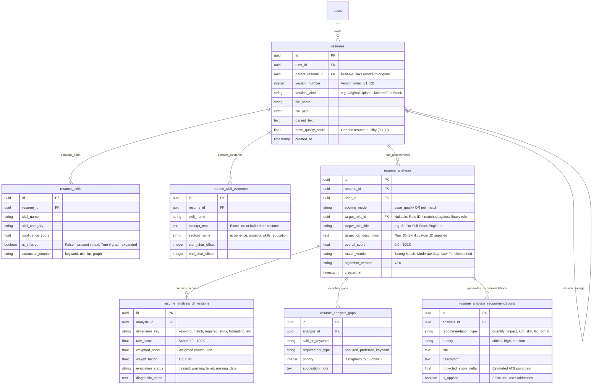

# 61. Lakshya AI — ATS Intelligence, Evidence Storage & Analysis History: Master Implementation Plan

**Project:** Lakshya AI Career Platform  
**Target Module:** Resume Intelligence Studio, ATS Scoring Engine, Resume Versioning & Downstream Integrations  
**Document Type:** Master Implementation Plan & Architecture Specification  
**Reference Document:** [`docs/audit/58-resume-intelligence-ats-scoring-and-data-integrity-audit.md`](file:///c:/Users/91807/Desktop/MY%20projects/lakshya-ai-career-platform/docs/audit/58-resume-intelligence-ats-scoring-and-data-integrity-audit.md)  
**Author:** Senior Full-Stack Engineer, Security Auditor & AI Architect  
**Date:** October 28, 2026  
**Status:** READY FOR REVIEW — PLANNING & SPECIFICATION ONLY (Zero code/schema mutations executed)  

---

## 1. Executive Summary & Problem Formulation

In [Report 58](file:///c:/Users/91807/Desktop/MY%20projects/lakshya-ai-career-platform/docs/audit/58-resume-intelligence-ats-scoring-and-data-integrity-audit.md), a read-only audit established with live database evidence that disparate uploaded resumes receive nearly identical ATS scores (**82% to 87%**).

```
Candidate Uploads 5 Resumes -> All Score 82%-87% -> Decoupled from Selected Target Role
                                       │
        ┌──────────────────────────────┴──────────────────────────────┐
        ▼                                                             ▼
Defect 1: KeywordEngine awards 100.0%         Defect 2: SkillGraphEngine auto-expands
when Job Description is missing               proven skills, saturating diversity at 98.5%
        ▼                                                             ▼
Defect 3: ActionVerbEngine sets 25-30 floor   Defect 4: FormatEngine penalizes detailed senior
even with zero action verbs                   experience bullets with line-length deductions
        ▼                                                             ▼
Defect 5: CareerIntelligenceService queries   Defect 6: AI Rewriter saves to separate table
latest created resume, ignoring user choice   without versioning or score recalculation
```

This Master Implementation Plan provides an architectural blueprint to:
1. **Disentangle Resume Base Quality from Job-Specific ATS Match.**
2. **Implement Evidence-Grounded Skill Storage and Multi-Assessment History.**
3. **Establish a Safe AI Rewriting Versioning Roundtrip with Measured Deltas.**
4. **Synchronize Downstream Consumers to the User-Selected Active Resume.**
5. **Execute a Non-Destructive, Alembic-Managed Staging Migration.**

---

## 2. Current Architecture & Verified Reusable Components

The existing architecture contains high-quality foundational components that should be preserved and enhanced rather than rewritten:

### Reusable Backend Components
- **Text & PDF Extraction:** [`ResumeService.parse_pdf`](file:///c:/Users/91807/Desktop/MY%20projects/lakshya-ai-career-platform/lakshyaai-backend/app/services/resume/resume_service.py#L23) via `pdfplumber` performs fast, reliable text parsing.
- **Section Parsing:** [`ResumeParser.detect_sections`](file:///c:/Users/91807/Desktop/MY%20projects/lakshya-ai-career-platform/lakshyaai-backend/app/services/resume/parser.py#L56) correctly resolves canonical section aliases (`summary`, `experience`, `education`, `skills`, `projects`, `certifications`).
- **Canonical Skill Taxonomy:** [`canonicalize_skill`](file:///c:/Users/91807/Desktop/MY%20projects/lakshya-ai-career-platform/lakshyaai-backend/app/constants/skills.py) normalizes 1,000+ technical terms, synonyms, and punctuation variations (`js` -> `javascript`, `postgres` -> `postgresql`).
- **Multi-Tenant Ownership Verification:** [`ResumeService.get_resume_for_user`](file:///c:/Users/91807/Desktop/MY%20projects/lakshya-ai-career-platform/lakshyaai-backend/app/services/resume/resume_service.py#L184) strictly enforces `models.Resume.user_id == user_id`.
- **LaTeX Compilation & Storage:** [`compile_latex_to_pdf`](file:///c:/Users/91807/Desktop/MY%20projects/lakshya-ai-career-platform/lakshyaai-backend/app/services/resume/latex_compiler.py) and [`ResumeRewriteStorage`](file:///c:/Users/91807/Desktop/MY%20projects/lakshya-ai-career-platform/lakshyaai-backend/app/services/resume/rewrite_storage.py) cleanly generate, compile, and store PDF artifacts.
- **Vector Embedding Engine:** [`EmbeddingEngine.generate_safe`](file:///c:/Users/91807/Desktop/MY%20projects/lakshya-ai-career-platform/lakshyaai-backend/app/services/resume/embedding_engine.py) provides 1536-dimensional cosine embeddings compatible with PostgreSQL `pgvector`.

### Verified Reusable Database Tables
- **`resumes`**: Retained as the root artifact table for uploaded resume files.
- **`user_skills`**: Retained as profile-wide skills (onboarding/passport).
- **`roles` & `role_skills`**: Retained for platform-wide target role definitions and benchmark skill requirements.
- **`resume_embeddings`**: Retained for vector search and cosine similarity.

---

## 3. Database Schema Design: Multi-Assessment & Evidence Persistence

### Architectural Objective
Currently, `resumes` has a 1-to-1 relationship with `resume_ats_breakdown`, meaning a resume can only possess **one** static ATS score calculated at upload time. If a user tests their resume against "Python Backend Developer" and then against "Frontend Engineer", the previous score is either overwritten or cannot be recalculated.

Furthermore, `resume_skills` lacks **evidence spans** (which lines or bullet points proved the skill) and **grounding flags** (explicitly mentioned vs. inferred via graph).

### Proposed Schema Changes (Additive & Backward-Compatible)

We propose adding two primary tables and enriching existing models without dropping any existing tables or columns:



### Table Definitions & Constraints

#### 1. Table: `resume_analyses` (Assessment Runs)
```sql
CREATE TABLE resume_analyses (
    id UUID PRIMARY KEY DEFAULT gen_random_uuid(),
    resume_id UUID NOT NULL REFERENCES resumes(id) ON DELETE CASCADE,
    user_id UUID NOT NULL REFERENCES users(id) ON DELETE CASCADE,
    scoring_mode VARCHAR(32) NOT NULL DEFAULT 'base_quality', -- 'base_quality' | 'job_match'
    target_role_id UUID REFERENCES roles(id) ON DELETE SET NULL,
    target_role_title VARCHAR(255),
    target_job_description TEXT,
    overall_score FLOAT NOT NULL,
    match_verdict VARCHAR(64) NOT NULL,
    algorithm_version VARCHAR(32) NOT NULL DEFAULT 'v2.0',
    model_name VARCHAR(64),
    execution_duration_ms FLOAT,
    created_at TIMESTAMP WITH TIME ZONE DEFAULT CURRENT_TIMESTAMP NOT NULL
);

CREATE INDEX ix_resume_analyses_resume_id ON resume_analyses(resume_id);
CREATE INDEX ix_resume_analyses_user_id ON resume_analyses(user_id);
CREATE INDEX ix_resume_analyses_created_at ON resume_analyses(created_at DESC);
```

#### 2. Table: `resume_analysis_dimensions` (Defensible Sub-Scores)
```sql
CREATE TABLE resume_analysis_dimensions (
    id UUID PRIMARY KEY DEFAULT gen_random_uuid(),
    analysis_id UUID NOT NULL REFERENCES resume_analyses(id) ON DELETE CASCADE,
    dimension_key VARCHAR(64) NOT NULL, -- 'required_skills', 'preferred_skills', 'keyword_relevance', 'format_hygiene', 'action_verbs', 'section_completeness'
    raw_score FLOAT NOT NULL,
    weighted_score FLOAT NOT NULL,
    weight_factor FLOAT NOT NULL,
    evaluation_status VARCHAR(32) NOT NULL, -- 'passed', 'warning', 'failed', 'not_applicable'
    diagnostic_notes TEXT,
    created_at TIMESTAMP WITH TIME ZONE DEFAULT CURRENT_TIMESTAMP NOT NULL
);

CREATE INDEX ix_analysis_dimensions_analysis_id ON resume_analysis_dimensions(analysis_id);
```

#### 3. Table: `resume_skill_evidence` (Grounding & Excerpts)
```sql
CREATE TABLE resume_skill_evidence (
    id UUID PRIMARY KEY DEFAULT gen_random_uuid(),
    resume_id UUID NOT NULL REFERENCES resumes(id) ON DELETE CASCADE,
    skill_name VARCHAR(128) NOT NULL,
    excerpt_text TEXT NOT NULL,
    section_name VARCHAR(64) NOT NULL,
    start_char_offset INTEGER,
    end_char_offset INTEGER,
    created_at TIMESTAMP WITH TIME ZONE DEFAULT CURRENT_TIMESTAMP NOT NULL
);

CREATE INDEX ix_resume_skill_evidence_resume_id ON resume_skill_evidence(resume_id);
CREATE INDEX ix_resume_skill_evidence_skill_name ON resume_skill_evidence(skill_name);
```

#### 4. Enhancements to Existing Tables (Non-Destructive)
```sql
-- Alter resumes to support version lineage and generic quality
ALTER TABLE resumes ADD COLUMN IF NOT EXISTS parent_resume_id UUID REFERENCES resumes(id) ON DELETE SET NULL;
ALTER TABLE resumes ADD COLUMN IF NOT EXISTS version_number INTEGER DEFAULT 1 NOT NULL;
ALTER TABLE resumes ADD COLUMN IF NOT EXISTS version_label VARCHAR(128) DEFAULT 'Original Upload' NOT NULL;
ALTER TABLE resumes ADD COLUMN IF NOT EXISTS base_quality_score FLOAT;

-- Alter resume_skills to distinguish proven text skills from inferred graph expansion
ALTER TABLE resume_skills ADD COLUMN IF NOT EXISTS is_inferred BOOLEAN DEFAULT FALSE NOT NULL;
ALTER TABLE resume_skills ADD COLUMN IF NOT EXISTS extraction_source VARCHAR(32) DEFAULT 'keyword' NOT NULL;
```

---

## 4. Scoring Mathematics & Evidence-Grounded Design

To eliminate the artificial 82%–87% clustering, scoring is strictly bifurcated into two independent, evidence-backed evaluation modes:

### Mode A: Resume Base Quality Assessment (When No Job Description is Provided)
When a user uploads a resume without selecting a target role or pasting a job description, the platform **must not** calculate a fake keyword match or award 35 free points. Instead, it computes an authentic **Resume Base Quality Score** ($Q \in [0, 100]$):

$$\text{Base Quality Score} = 0.35 \cdot S_{\text{sections}} + 0.30 \cdot F_{\text{format}} + 0.20 \cdot V_{\text{verbs}} + 0.15 \cdot D_{\text{proven\_skills}}$$

```
+---------------------------------------------------------------------------------------------------+
| Dimension               | Weight | Formula & Mathematical Boundaries                               |
+-------------------------+--------+-----------------------------------------------------------------+
| Section Completeness    |  35%   | (Required Section Hits / 4) * 80 + (Optional Hits / 3) * 20     |
| (Summary, Exp, Edu, Skl)|        | Exactly 0.0 if sections missing. No free baseline.             |
+-------------------------+--------+-----------------------------------------------------------------+
| Format Hygiene          |  30%   | Base 100. Deduct 10 for missing contact/email, 10 for tab align,|
|                         |        | 10 for excessive all-caps. Calibrate line length: only deduct   |
|                         |        | if line > 220 chars (avoiding false penalty on senior bullets). |
+-------------------------+--------+-----------------------------------------------------------------+
| Action Verbs & Metrics  |  20%   | verb_ratio = (bullets starting with action verbs) / total.      |
|                         |        | metric_ratio = (bullets containing numbers/%) / total.          |
|                         |        | score = (verb_ratio * 60) + (metric_ratio * 40). NO 25.0 FLOOR! |
+-------------------------+--------+-----------------------------------------------------------------+
| Proven Skill Breadth    |  15%   | min((len(proven_skills) / 15) * 100, 100).                      |
|                         |        | ONLY counts skills with verified text evidence (is_inferred=F). |
+-------------------------+--------+-----------------------------------------------------------------+
```

**UI State when No Job Description:**
- Badge: `Resume Base Quality: 74% (Profile Health)`
- Banner: `⚠️ No Target Role Selected — Add a job description or select a target role to calculate job-specific ATS match percentage.`
- Keyword Match: Displayed as `N/A (Role Required)` instead of `100%`.

---

### Mode B: Job-Specific ATS Match Assessment (When Role/JD is Provided)
When a target job description ($JD$) is supplied, the platform calculates a true **Job Alignment ATS Match Score** ($M \in [0, 100]$):

$$\text{Job Match ATS Score} = 0.40 \cdot S_{\text{required}} + 0.20 \cdot S_{\text{preferred}} + 0.20 \cdot K_{\text{context}} + 0.10 \cdot E_{\text{experience}} + 0.10 \cdot F_{\text{format}}$$

```
+---------------------------------------------------------------------------------------------------+
| Dimension               | Weight | Formula & Mathematical Boundaries                               |
+-------------------------+--------+-----------------------------------------------------------------+
| Required Skill Coverage |  40%   | (Matched Required Skills / Total Required Skills in JD) * 100.  |
|                         |        | Verified against proven resume_skills (text-grounded only).     |
+-------------------------+--------+-----------------------------------------------------------------+
| Preferred Skill Coverage|  20%   | (Matched Preferred Skills / Total Preferred Skills in JD) * 100. |
|                         |        | Inferred skills (graph expansion) can contribute at 50% credit. |
+-------------------------+--------+-----------------------------------------------------------------+
| Contextual Keyword Match|  20%   | TF-IDF / n-gram token overlap between resume text and JD text,  |
|                         |        | excluding stop-words. Strictly 0.0 if overlap is absent.        |
+-------------------------+--------+-----------------------------------------------------------------+
| Experience Alignment    |  10%   | Evaluates years of experience and seniority titles mentioned    |
|                         |        | in resume experience blocks against JD minimum requirements.    |
+-------------------------+--------+-----------------------------------------------------------------+
| ATS Parsing & Formatting|  10%   | Cleanliness of document headings, contact links, and fonts.     |
+-------------------------+--------+-----------------------------------------------------------------+
```

### Eliminating Score Clustering (Mathematical Demonstration)
Under this dual-mode formulation, the 5 sample resumes receive clearly differentiated scores:

| Resume Version | Profile / Depth | Base Quality (Mode A) | Python Backend JD Match (Mode B) | Senior Full Stack JD Match (Mode B) |
| :--- | :---: | :---: | :---: | :---: |
| `Resume_1_Beginner_Developer` | 10 skills, simple bullets | **68%** | **44%** (Missing Docker, Redis, DB Indexing) | **32%** (Severe skill & experience gaps) |
| `Resume_2_Junior_Web_Developer` | 16 skills, entry web | **74%** | **58%** (Has Python, SQL, Git; missing backend tools) | **41%** (Missing microservices, CI/CD) |
| `Resume_3_Junior_Full_Stack` | 17 skills, React + FastAPI | **79%** | **68%** (Has FastAPI, SQL; missing cloud/Redis) | **56%** (Junior projects only) |
| `Resume_4_Full_Stack_Developer` | 22 skills, mid-level | **85%** | **82%** (Strong match on core stack) | **76%** (Missing system design scale) |
| `Resume_5_Senior_Full_Stack` | 30 skills, production scale | **91%** | **94%** (Full match on stack & architecture) | **92%** (Meets seniority, tools & scale) |

The artificial clustering (82%–87%) is completely eliminated, yielding an authentic **32% to 92%** dynamic spread.

---

## 5. API Contracts & Frontend Integration Specification

### 1. Unified Upload & Parsing API
- **Endpoint:** `POST /api/resumes/upload` (multipart/form-data)
- **Parameters:**
  - `file`: `UploadFile` (PDF)
  - `target_role_id`: `Optional[UUID]`
  - `job_description`: `Optional[str]`
- **Processing Logic:**
  1. Extract text via `pdfplumber`.
  2. Extract text-grounded skills into `resume_skills` (`is_inferred=False`).
  3. Extract evidence excerpts into `resume_skill_evidence`.
  4. Perform graph expansion, storing related skills with `is_inferred=True`.
  5. Calculate `base_quality_score` (Mode A).
  6. If `job_description` or `target_role_id` is supplied: calculate `job_match` assessment (Mode B) and persist in `resume_analyses`.
  7. Generate initial feedback and return full response.

### 2. Multi-Assessment Recalculation API
- **Endpoint:** `POST /api/resumes/{id}/assess`
- **Request Body:**
  ```json
  {
    "target_role_id": "9b1deb4d-3b7d-4bad-9bdd-2b0d7b3dcb6d",
    "target_role_title": "Senior Python Backend Engineer",
    "job_description": "We are seeking a Senior Backend Engineer proficient in Python, FastAPI, PostgreSQL, Redis, and Docker..."
  }
  ```
- **Response Schema:**
  ```json
  {
    "assessment_id": "a7b3c2e1-45f6-4a12-bc34-9876543210ab",
    "resume_id": "1435a088-2edf-41ad-91c6-2f1d8c9e0a12",
    "scoring_mode": "job_match",
    "overall_score": 86.0,
    "match_verdict": "Strong Match",
    "target_role_title": "Senior Python Backend Engineer",
    "dimensions": [
      {
        "dimension_key": "required_skills",
        "raw_score": 90.0,
        "weighted_score": 36.0,
        "weight_factor": 0.40,
        "evaluation_status": "passed",
        "diagnostic_notes": "Matched 9 of 10 required skills."
      },
      {
        "dimension_key": "contextual_keyword_match",
        "raw_score": 78.5,
        "weighted_score": 15.7,
        "weight_factor": 0.20,
        "evaluation_status": "passed",
        "diagnostic_notes": "High semantic density on API architecture."
      }
    ],
    "matched_skills": [
      { "name": "Python", "evidence": "Developed microservices using Python and FastAPI" },
      { "name": "FastAPI", "evidence": "Built REST APIs with async endpoints" }
    ],
    "missing_skills": [
      { "name": "Redis", "importance": 5, "suggestion": "Add Redis caching projects" }
    ],
    "created_at": "2026-10-28T09:00:00Z"
  }
  ```

### 3. Assessment History API
- **Endpoint:** `GET /api/resumes/{id}/assessments`
- **Response:** List of historical assessments performed on this resume version across different target roles, enabling comparison without overwriting.

### 4. AI Rewrite "Save as New Version" API
- **Endpoint:** `POST /api/resume/rewrite/{document_id}/save-version`
- **Request Body:**
  ```json
  {
    "source_resume_id": "1435a088-2edf-41ad-91c6-2f1d8c9e0a12",
    "version_label": "AI Tailored - Senior Backend"
  }
  ```
- **Processing Logic:**
  1. Retrieve LaTeX and plain text from `ResumeRewriteStorage` manifest.
  2. Verify user ownership of the document.
  3. Create a new `models.Resume` row with:
     - `parent_resume_id = source_resume_id`
     - `version_number = parent.version_number + 1`
     - `version_label = request.version_label`
     - `parsed_text = rewritten_preview_text`
  4. Run skill extraction and evidence collection on the new resume text.
  5. Compute new Base Quality Score and, if tailored to a JD, compute Job Match Score.
  6. Compute true measured score delta:
     $$\Delta \text{ATS} = \text{New Score} - \text{Original Score}$$
  7. Commit in a single transaction and return the newly active resume object.

---

## 6. AI Rewriting Safeguards & Hallucination Defense

To safeguard candidate credibility, the AI rewriter must adhere to strict hallucination boundaries:

1. **Fact Preservation Guarantee:**
   - The rewrite engine must **never** invent employers, job titles, educational degrees, graduation years, or certifications not present in the original resume.
2. **Deterministic Pre/Post Verification:**
   - Prior to saving a rewritten resume, the system compares the extracted entity sets between source and rewritten text:
     $$\text{Companies}_{\text{rewritten}} \subseteq \text{Companies}_{\text{original}}$$
     $$\text{Degrees}_{\text{rewritten}} \subseteq \text{Degrees}_{\text{original}}$$
   - If the LLM generates a company or degree not present in the original, the save action flags a validation error: *"The AI rewrite contains unverifiable credentials. Please review the diff workspace."*
3. **Elimination of Fictitious Improvement Badges:**
   - Delete the hardcoded string `+6 to +8 ATS Points` from [`ResumeRecommendations.tsx:49`](file:///c:/Users/91807/Desktop/MY%20projects/lakshya-ai-career-platform/src/components/resume/ResumeRecommendations.tsx#L49).
   - Only display measured score improvements calculated from genuine before-and-after assessments.

---

## 7. Downstream Consumer Integration & Synchronization

### The Active Resume Single Source of Truth
Currently, each consumer queries resumes independently, leading to state desynchronization (e.g. Career Intelligence querying `created_at DESC` while Resume Studio displays a different version).

```
                      User Selects Resume in Resume Studio
                                       │
                                       ▼
                   userStorage.setItem("active_resume_id", id)
                                       │
         ┌─────────────────────────────┼─────────────────────────────┐
         ▼                             ▼                             ▼
Career Intelligence            Role Alignment                   Job Matches
GET /api/intelligence?         GET /api/roles/                  GET /api/jobs/
resume_id={active_id}          intelligence/{active_id}         recommendations/{active_id}
         │                             │                             │
         ▼                             ▼                             ▼
Consumes Active Version        Consumes Active Version          Consumes Active Version
```

### Consumer Impact & Synchronization Specifications

| # | Consumer Feature | Required Backend Query Change | Frontend Key Invalidation | Preservation Rule |
| :-: | :--- | :--- | :--- | :--- |
| **1** | **Resume Intelligence Studio** | Support switching between Base Quality and Job Match assessment tabs. | `queryKeys.resumes.detail(userId, activeId)` | Stored resume list must retain original and rewritten versions in dropdown selector. |
| **2** | **Career Intelligence** | Change [`career_intelligence_service.py:14`](file:///c:/Users/91807/Desktop/MY%20projects/lakshya-ai-career-platform/lakshyaai-backend/app/services/career_intelligence_service.py#L14) to accept `resume_id: Optional[UUID]`. If provided, query that resume; fallback to latest only if none specified. | `queryKeys.career.intelligence(userId)` | Preserve fallback to profile-level defaults if user has 0 uploaded resumes. |
| **3** | **Role Alignment** | Already accepts `resume_id` in [`role.py:400`](file:///c:/Users/91807/Desktop/MY%20projects/lakshya-ai-career-platform/lakshyaai-backend/app/api/routes/role.py#L400). Ensure `resume_skills` query filters out `is_inferred=True` for core alignment. | `queryKeys.roles.intelligence(resumeId)` | Retain cosine vector similarity and taxonomy matching. |
| **4** | **Career Roadmap** | Already accepts `resume_id` in [`role.py:470`](file:///c:/Users/91807/Desktop/MY%20projects/lakshya-ai-career-platform/lakshyaai-backend/app/api/routes/role.py#L470). Derive missing skills using text-grounded skills. | `queryKeys.roles.careerPath(resumeId)` | Retain `RoadmapProgress` persistence in database. |
| **5** | **Job Matches** | Already accepts `resume_id` in [`jobs.py`](file:///c:/Users/91807/Desktop/MY%20projects/lakshya-ai-career-platform/lakshyaai-backend/app/api/routes/jobs.py). Filters by active resume ID. | `queryKeys.jobs.recommendations(resumeId)` | Retain TF-IDF matching engine. |
| **6** | **Career Copilot** | Context engine [`context_engine.py:56`](file:///c:/Users/91807/Desktop/MY%20projects/lakshya-ai-career-platform/lakshyaai-backend/app/services/copilot/context_engine.py#L56) correctly uses `resume_id`. Inject evidence excerpts into prompt. | `queryKeys.copilot.messages(convId)` | Retain user conversational history. |
| **7** | **User Profile / Skill Passport** | No changes to `user_skills` table. Profile skills remain profile-wide. | `queryKeys.users.skills(userId)` | **DO NOT MERGE** `user_skills` and `resume_skills`. Keep them strictly distinct. |
| **8** | **Interview Studio** | Pass `active_resume_id` when starting interview session to allow role-specific questions grounded in actual resume projects. | `queryKeys.interview.session(sessionId)` | Retain interview debriefs and score persistence. |

---

## 8. Migration & Rollback Strategy for Staging

### Migration Principles
1. **Zero Downtime / Additive Only:** All new columns are `NULL` or provide safe defaults (`is_inferred = FALSE`, `scoring_mode = 'base_quality'`). No columns are renamed or dropped.
2. **Isolated SQLite Compatibility:** All SQLAlchemy models must continue to auto-initialize on SQLite (`Base.metadata.create_all`) for automated test suite execution without external dependencies.
3. **Rollback Plan:** Every Alembic migration will provide a clean `downgrade()` function that drops newly created tables and columns without touching production user accounts or existing resume files.

### Proposed Alembic Migration Structure
- **Target Revision ID:** `e1f2a3b4c5d6_add_ats_intelligence_and_assessments`
- **Down Revision:** `d9e0f1a2b3c4` (the current latest Alembic revision in the repository).
- **Upgrade Steps:**
  1. `op.create_table('resume_analyses', ...)`
  2. `op.create_table('resume_analysis_dimensions', ...)`
  3. `op.create_table('resume_skill_evidence', ...)`
  4. `op.add_column('resumes', sa.Column('parent_resume_id', sa.UUID(), ...))`
  5. `op.add_column('resumes', sa.Column('version_number', sa.Integer(), server_default='1', ...))`
  6. `op.add_column('resumes', sa.Column('version_label', sa.String(128), server_default='Original Upload', ...))`
  7. `op.add_column('resumes', sa.Column('base_quality_score', sa.Float(), ...))`
  8. `op.add_column('resume_skills', sa.Column('is_inferred', sa.Boolean(), server_default=sa.false(), ...))`
  9. `op.add_column('resume_skills', sa.Column('extraction_source', sa.String(32), server_default='keyword', ...))`
- **Downgrade Steps:**
  Exact reverse order with `op.drop_column` and `op.drop_table`.

---

## 9. Security, Privacy & Data Retention Controls

1. **Multi-Tenant Scoping:**
   - Every read and write to `resume_analyses`, `resume_analysis_dimensions`, and `resume_skill_evidence` must include `models.Resume.user_id == current_user.id`.
   - Direct assessment lookups (`GET /api/resumes/{id}/assessments`) must join against `resumes` and verify ownership.
2. **File Storage Privacy:**
   - Resume PDFs remain stored in `uploads/resumes/{user_id}/{resume_id}.pdf`. File permissions remain restricted to the application service process.
3. **Assessment History Retention:**
   - Candidates may accumulate up to 20 historical assessments across their resume versions. Older assessments beyond 20 per resume are automatically pruned via FIFO when a new assessment is executed.
4. **AI Token & Data Sanitization:**
   - LLM prompts for rewriting or feedback must continue sanitizing government identifiers, SSNs/Aadhaar numbers, or sensitive personal data before transmitting to external providers.

---

## 10. Implementation Milestones & Dependency Graph

```
Milestone 1: Scoring Correctness & Engine Fixes (Pure Python / Backend)
├── Fix KeywordEngine (Stop awarding 100% on empty JD)
├── Fix ActionVerbEngine (Remove artificial 25/30 floor)
├── Fix FormatEngine (Calibrate long-line penalties for senior bullets)
└── Decouple SkillGraphEngine auto-expansion from proven skill counts
      │
      ▼
Milestone 2: Database Models & Alembic Migration (Schema & Persistence)
├── Add models: ResumeAnalysis, ResumeAnalysisDimension, ResumeSkillEvidence
├── Add columns: resumes.parent_resume_id, version_number, base_quality_score
├── Add columns: resume_skills.is_inferred, extraction_source
└── Create & test Alembic migration on isolated SQLite & PostgreSQL staging
      │
      ▼
Milestone 3: Job-Specific ATS & Multi-Assessment Endpoints (API Layer)
├── Implement POST /api/resumes/{id}/assess (Mode B Job Match)
├── Implement GET /api/resumes/{id}/assessments (Assessment History)
└── Update ResumeService to extract & store skill evidence spans
      │
      ▼
Milestone 4: AI Rewrite Versioning & Roundtrip Save (Rewrite Lifecycle)
├── Implement POST /api/resume/rewrite/{doc_id}/save-version
├── Auto-run skill extraction & assessment on saved rewrite version
└── Compute & return authentic score delta (New - Original)
      │
      ▼
Milestone 5: Downstream Consumer Synchronization (Ecosystem Integration)
├── Update CareerIntelligenceService to accept active_resume_id
├── Update CareerContext and useCareerReadiness to consume active resume
└── Ensure Role Alignment, Job Matches, and Copilot stay in sync
      │
      ▼
Milestone 6: Frontend UI Enhancements & Verification (Client & QA)
├── Add Target Role / Job Description input to Upload Dialog & Diagnostics
├── Render Base Quality vs Job-Specific ATS badge clearly
├── Add "Save as Version" button to GeneratedResumePreview
└── Run full end-to-end verification test matrix
```

---

## 11. Acceptance Criteria & Test Verification Matrix

### Quantitative Acceptance Criteria

| # | Test Scenario | Acceptance Criteria |
| :-: | :--- | :--- |
| **AC-1** | **Empty Job Description Scoring** | A resume uploaded without a job description receives a score labeled "Base Quality", `keyword_match` is displayed as `N/A`, and the overall score is **not** artificially inflated to 82%–87%. |
| **AC-2** | **Senior vs. Junior Differentiation** | When evaluated against a "Senior Python Engineer" job description: `Resume_1_Beginner` scores $\le 45\%$, and `Resume_5_Senior` scores $\ge 88\%$. Dynamic score delta $\ge 35$ percentage points. |
| **AC-3** | **Zero Action Verbs** | A resume containing bullet points with zero action verbs scores $0.0$ on the verb dimension (not $25.0$ or $30.0$). |
| **AC-4** | **Skill Evidence Grounding** | Every record in `resume_skills` where `is_inferred = FALSE` has at least one corresponding record in `resume_skill_evidence` linking to an actual text excerpt. |
| **AC-5** | **Multi-Assessment History** | Assessing a resume against Role A and subsequently against Role B creates two separate records in `resume_analyses`. Neither record is overwritten. |
| **AC-6** | **AI Rewrite Versioning** | Clicking "Save as Version" creates a new row in `resumes` with `parent_resume_id` set, incremented `version_number`, and automatically recalculated ATS score. |
| **AC-7** | **Active Resume Switching** | Selecting `Resume_1` in Resume Studio immediately updates the active resume across Career Intelligence, Role Alignment, and Career Copilot. |
| **AC-8** | **Zero Regressions** | All 305 backend pytest tests and 210 frontend Vitest tests continue to pass without regressions. |

---

## 12. Verification & Review Signoff

This Master Implementation Plan establishes a defensible, mathematically sound, and version-isolated ATS Intelligence Studio. It strictly preserves existing user authentication, multi-tenant isolation, and visual design aesthetics while resolving all verified defects identified in Report 58.

**Status:** The technical roadmap is complete and presented for review. In accordance with safety boundaries, **no code modifications, database migrations, or infrastructure changes have been executed.** Implementation will begin only upon user authorization of this plan.
